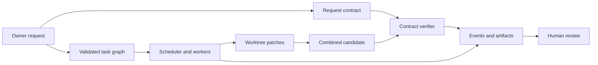

# Orkestr

**A local-first runtime for planning, executing and reviewing software-engineering work with agents.**

Orkestr turns a repository request into a graph of tasks, runs workers in Git
worktrees, checks their changes, combines their patches, and records the result
for inspection and recovery. Its Python distribution and CLI are named
`agent-squad`; its source package is `agent_squad`.

The central distinction is **a worker finished** versus **the original request
was accepted**. The first is an execution outcome. The second requires a final
candidate tree evaluated against the owner's request contract. Neither is a
proof of correctness beyond the checks that were actually required and run.

[Documentation home](docs/README.md) · [In-depth project guide](docs/project-guide.md)
· [Quickstart](docs/getting-started.md) · [Current status](PROJECT_STATUS.md)

## What it does

1. Inspect the target repository and build an owner-defined request contract.
2. Produce and validate a task DAG, including dependencies and scope.
3. Select a scheduling strategy and dispatch bounded worker attempts.
4. Mediate tool access, protected actions, resource limits and cancellation.
5. Verify task changes, integrate candidate patches in a staging worktree, and
   judge the combined tree against the original contract.
6. Return a reviewable patch bundle, structured outcomes, usage records and
   durable events. Internal worktrees may contain generated commits; the normal
   run does not publish a commit or update a remote branch for you.



## Start here

The documented release matrix is Linux x86-64 with Python 3.11–3.13. The package
metadata permits Python 3.11+, but that broader range is not the same as release
qualification. Git must be available. The hardened execution profile additionally
needs a usable containment backend; unsupported containment is refused.

```bash
# From the repository root, using a supported interpreter:
python3.11 -m venv .venv
. .venv/bin/activate
python -m pip install --require-hashes -r requirements.lock
python -m pip install --no-deps -e .
agent-squad --help
```

For an editable development environment outside the release-lock procedure,
`python -m pip install -e '.[dev]'` installs the declared development extra.
That is a different reproducibility claim. FastAPI and uvicorn are optional
service dependencies; there is currently no `api` extra in `pyproject.toml`.

The [quickstart](docs/getting-started.md) creates a disposable repository and
runs the supplied rounding request with the deterministic mock provider. No
model download or paid API is required. The mock exercises actual file tools,
worktrees, checks and integration; it does not demonstrate model reasoning.

## Use a model endpoint

```bash
agent-squad run "Implement the declared request" \
  --repo /absolute/path/to/repository \
  --spec /absolute/path/to/request.json \
  --provider openai_compat --model YOUR_SERVED_MODEL \
  --base-url http://127.0.0.1:8081/v1 --json
```

An OpenAI-compatible adapter and an Anthropic adapter are implemented. Endpoint
compatibility still depends on its chat, tool and structured-output behavior.
An Anthropic-shaped API is not automatically interchangeable with an
OpenAI-compatible endpoint. Configure credentials through the named environment
variable and provider configuration; see [configuration](docs/configuration.md).

Without owner-supplied acceptance criteria, a run may produce useful work but
cannot establish independently defined request acceptance. With `--no-integrate`,
the final combined candidate is not judged through the normal integration path.
Inspect the returned `contract` field, not only the task status or CLI exit code.

## Understand the outcome

| Signal | What it establishes |
|---|---|
| Worker/task status | Whether execution and task checks completed |
| Evidence ladder | Which kinds of evidence were recorded for a task |
| Contract verdict | Whether the candidate met the declared request checks |
| Human approval | Authorization for a particular protected action |
| Formal project qualification | Independent evidence under the scoring policy |

These signals are related, but none is a substitute for the others. A passing
fixture, approved command or `succeeded` task does not certify a production fix.

## Current evidence

- The historical local experiment retained **62 completed workflow trials and
  2 cancellations**, plus **45 direct requests** across eight checkpoints and a
  CPU baseline. Its original timing sample had a residual-server limitation.
- A later, smaller timing sample records verified process ownership. It tests
  the measurement mechanism; it does not replace a held-out repository study.
- The published generated verifier corpus contains **600 adversarial cases and
  160 known-correct cases**. Its independence assumptions and generalization
  still require review; it is not a benchmark of real coding tasks.
- The assessment distinguishes implementation from qualification. Independent
  review, real-repository gains and sustained external use remain unqualified.

See [the evidence guide](docs/evaluation.md), [measured results](docs/benchmark-results.md)
and [strict scoring criteria](docs/scoring-criteria.md). Historical measurements
are retained with their original conditions rather than rewritten as current
release guarantees.

## Documentation map

| If you want to… | Read |
|---|---|
| Understand the project in depth | [Project guide](docs/project-guide.md) |
| Run a safe, disposable example | [Getting started](docs/getting-started.md) |
| Understand contracts, scopes and outcomes | [Concepts](docs/concepts.md) |
| Configure providers, limits and containment | [Configuration](docs/configuration.md) |
| Trace the runtime and source | [Architecture](docs/architecture.md), [deep dive](docs/deep-dive.md), [walkthrough](docs/implementation-walkthrough.md) |
| Operate, inspect, cancel or recover a run | [Operations](docs/operations.md), [CLI and API reference](docs/reference.md) |
| Understand trust and failure boundaries | [Security](docs/security-threat-model.md), [reliability](docs/reliability.md), [limitations](docs/limitations.md) |
| Reproduce or interpret measurements | [Evaluation](docs/evaluation.md), [reproduction](docs/reproduction.md) |
| Contribute or assess the project | [Contributing](docs/contributing.md), [roadmap](docs/roadmap.md), [scoring](docs/scoring-criteria.md) |
| Use the example requests or UI | [Examples](examples/README.md), [dashboard](dashboard/README.md) |

## Scope

The supported design is a local, single-user, single-host application backed by
SQLite and Git. Development isolation is best effort. Hardened isolation is an
explicit execution profile that must demonstrate the required boundaries or
refuse to run. The API is a trusted local control surface, not a public,
authenticated multi-tenant service. Read the security model before using an
untrusted repository or granting network, deletion, commit or push authority.

The project does not yet establish that more agents improve real-repository
completion, latency or cost. Its purpose is to make that question testable and
to make unsuccessful or inconclusive results visible.
