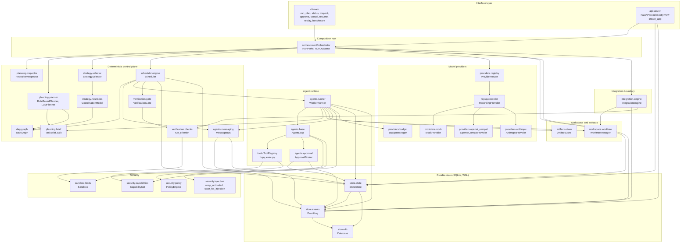
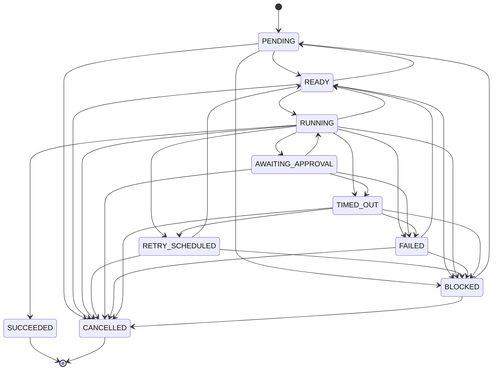
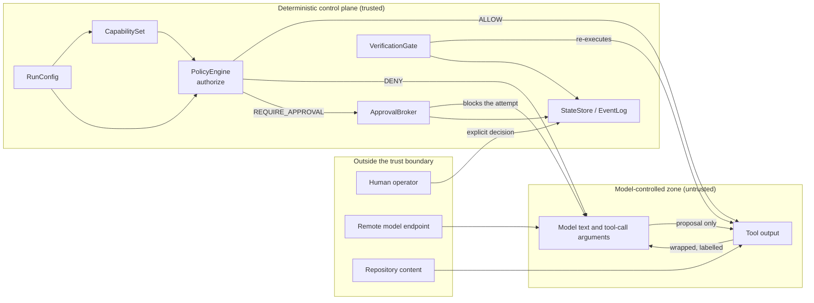
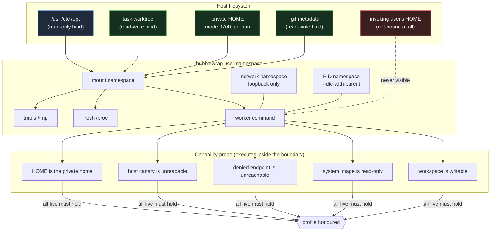
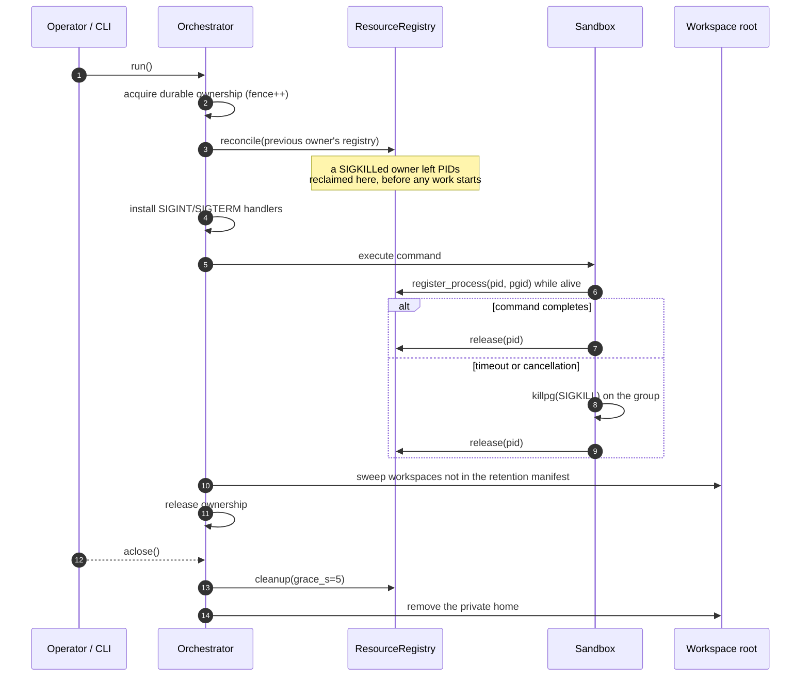

# Architecture

`agent-squad` is a local, single-host orchestration runtime for multi-agent
software engineering. It turns a request into a task DAG, executes the tasks
concurrently in isolated git worktrees, verifies each task by re-running its
acceptance criteria against the worker's own output, integrates the resulting
patches, and records every step in an append-only event log.

Three properties shape the whole design:

1. **Deterministic control plane.** Every lifecycle transition, budget
   decision, policy decision and verification decision is made by ordinary
   code against static configuration. Models propose; they never dispose.
2. **Evidence, not assertion.** A task is "done" only when the orchestrator
   has independently executed that task's acceptance criteria and recorded the
   result. A worker's claim never advances the state machine on its own.
3. **Local-first durability.** One SQLite database in WAL mode holds the
   append-only event log (the source of truth) and the projections derived
   from it.

This document describes the system as it is implemented in `src/agent_squad/`.
Where a described capability is only partially wired, that is stated
explicitly in [Known limitations](#13-known-limitations).

---

## 1. Component diagram



Two structural points are worth calling out:

* **`Orchestrator` is the only composition root.** It constructs the
  `Database`, `EventLog`, `StateStore`, `ArtifactStore`, `WorktreeManager`,
  `PolicyEngine`, `ApprovalBroker`, `VerificationGate`, `MessageBus`,
  `BudgetManager`, `WorkerRunner` and `Scheduler`, and it is the only place
  that knows their concrete types. Every component receives the run's
  `RunConfig` rather than reading globals.
* **The scheduler is the only component that decides what runs next.** It
  owns the ready queue, the concurrency limit, the retry policy, the
  deadlines and cancellation propagation. Nothing else dispatches work.
* **The model is never on the authorisation path.** `PolicyEngine` and
  `ApprovalBroker` are constructed from static configuration and durable
  state; the model can only request an action, never authorise one.

---

## 2. Execution lifecycle

The walkthrough below follows `Orchestrator.run()` in
`src/agent_squad/orchestrator.py` and `Scheduler.run()` /
`Scheduler._execute()` in `src/agent_squad/scheduler/engine.py`.

### 2.1 Orchestration phase

1. **`Orchestrator.__init__`** creates the run directory (`RunPaths.for_run`,
   `RunPaths.ensure`), opens the SQLite database (`Database`), and writes
   `run-config.json` so the run can be replayed later without the operator
   reconstructing the configuration. It also builds the `EventLog`,
   `StateStore`, `ArtifactStore`, `WorktreeManager`, `PolicyEngine`,
   `VerificationGate` and `MessageBus`.
2. **`Orchestrator.run`** calls `StateStore.create_run` (run status
   `CREATED`, config and objective recorded as metadata) and then
   `StateStore.set_run_status(..., RunStatus.PLANNING)`.
3. **Repository inspection.** `RepositoryInspector(config.repo_path).inspect()`
   produces a shallow `RepoContext`: file inventory, language histogram, test
   files, manifest files, directories, and any injection findings from
   `scan_for_injection`. The inspector never executes anything from the
   repository and never follows symlinks.
4. **Planning.** `build_planner(config, provider)` selects `RuleBasedPlanner`
   when `config.provider.name == "mock"` and `LLMPlanner` otherwise. The
   planner is called with a `PlanRequest` and returns a `PlanResult` containing
   `TaskSpec` objects and per-task `TaskBrief` objects. Both planners end with
   `validate_plan(result)`, which calls `TaskGraph.validate(...)` and raises
   `ValidationError` on structural problems. `RuleBasedPlanner` emits a
   warning when the plan contains no deterministic acceptance criteria.
5. **Plan recording.** `EventLog.append(EventType.PLAN_CREATED, ...)` writes
   the plan, its rationale and its warnings to the event log. `plan.graph()`
   builds the `TaskGraph`; `StateStore.upsert_task` registers each task in
   the `tasks` projection and emits `TASK_CREATED`.
6. **Strategy selection.** `StrategySelector(config.strategy).select(graph,
   override=..., max_workers_override=..., token_budget=...,
   cost_budget_usd=..., price_per_1k_tokens=...)` returns a
   `StrategyDecision`. The decision is recorded as `STRATEGY_SELECTED` and
   carries a `rationale` tuple and a `factors` dictionary so the reasoning
   can be audited later. The run status moves to `RUNNING`.
7. **Scheduling.** `Orchestrator` computes `max_workers = min(decision.
   worker_count or config.scheduler.max_workers, config.scheduler.
   max_workers)`, resolves `base_revision` from `WorktreeManager.
   head_revision()`, constructs `WorkerRunner` and `Scheduler`, and awaits
   `Scheduler.run()`.

### 2.2 Scheduling phase

8. **Initial dispatch.** `Scheduler.run` moves every task from `PENDING` to
   `READY` via `StateStore.transition_task`, then enters its event loop.
9. **Each iteration of the loop:**
   * If `self.cancellation` is set, every pending task is moved to
     `CANCELLED` and the loop breaks.
   * `TaskGraph.blocked_by_failure(failed)` computes the tasks that can never
     run because an ancestor failed; each is moved to `BLOCKED` with
     `error_class="dependency"`.
   * The ready set is the pending tasks whose dependencies are all in
     `completed`, sorted by `(-priority, task_id)`. Up to `max_workers` tasks
     are dispatched with `asyncio.create_task(self._execute(task))`.
   * `asyncio.wait(..., return_when=FIRST_COMPLETED)` reaps completed
     attempts and updates the `completed` / `failed` / `cancelled` sets.
10. **`Scheduler._execute(task)`** runs the retry loop, bounded by
    `min(task.budget.max_attempts, config.retry.max_attempts)`:
    * `StateStore.start_attempt(task.id, owner=..., lease_ttl_s=...)` fences
      the attempt: it increments the monotonic attempt counter, records the
      owner, and sets `lease_expires_at`.
    * `StateStore.transition_task(task.id, RUNNING, attempt=attempt)`. A
      `StaleAttemptError` here means a newer attempt already owns the task,
      and the worker returns immediately.
    * `asyncio.wait_for(self.runner.execute(task, brief, attempt=attempt,
      cancellation=..., base_revision=self._base_for(task)),
      timeout=self._timeout_for(task))`. `_base_for(task)` returns the head
      revision produced by the last completed dependency, so a dependent task
      starts from its dependency's output.
    * **Timeout** → the task moves to `TIMED_OUT` (`error_class="timeout"`),
      then to `RETRY_SCHEDULED`, then back to `READY` after
      `self._backoff(attempts, task.id)`.
    * **Worker returned a failure** → the task moves to `FAILED` with the
      worker's `error_class` and `error`. The failure is retried unless
      `error_class` is one of `policy`, `validation` or `budget`.
    * **Worker succeeded** → `Scheduler._verify(task, result)` runs the
      independent verification (section 2.4). A failed verification moves the
      task to `FAILED` with `error_class="verification"` and is always
      retryable.
    * **Verified** → the task moves to `SUCCEEDED` and a
      `TASK_ATTEMPT_FINISHED` event is appended.
11. **Summary.** `Scheduler._summarise` builds the `RunSummary` (per-status
    counts, token and cost totals, wall clock, a histogram of verification
    levels). `Scheduler._final_status` maps it to `CANCELLED`,
    `COMPLETED_WITH_FAILURES` or `SUCCEEDED`, which is written with
    `StateStore.set_run_status`.

### 2.3 Worker attempt

`WorkerRunner.execute(task, brief, ...)` owns one attempt:

12. `WorktreeManager.create(task.id, base_revision=...)` creates a detached
    worktree at the base revision. `AGENT_STARTED` is appended.
13. `capabilities_for_role(task.role)` produces the `CapabilitySet`;
    `ToolContext` is built with the worktree as `workdir` and `scope_root`,
    and `task.scope.exclude_paths` as `scope_patterns`.
14. `WorkerRunner.build_tools(role)` registers the role's tools. `read_file`,
    `list_dir`, `run_command`, `git_diff` and `git_status` are available to
    every role; `write_file` is registered only for `IMPLEMENTER` and
    `TEST_ENGINEER`. The reviewer therefore cannot modify the tree even if it
    tries.
15. `WorkerRunner._build_prompt` renders the objective, description, declared
    acceptance criteria and the authoritative `TaskBrief` into the prompt.
16. `AgentLoop.run` executes the bounded loop: build `ModelRequest`, call
    `provider.complete`, enforce the task token and cost ceilings, execute
    each requested tool call, append the rendered result, repeat until the
    model stops asking for tools or `max_iterations` is reached. Tool
    results are passed through `redact_secrets` and `wrap_untrusted` before
    they re-enter the context.
16a. **Authorisation happens inside the loop, before the tool runs.**
    `AgentLoop._invoke_tool` consults `PolicyEngine.authorize` with the
    caller's `CapabilitySet`, the tool's declared `ToolRule`, the scope root
    and the scope patterns. A `DENY` is returned to the model as a tool
    error with `error_class="policy"` — the tool is never executed, but the
    agent can adapt and try something else. A `REQUIRE_APPROVAL` is routed
    to the `ApprovalBroker`, which blocks the attempt until a human decision
    is recorded or `ApprovalConfig.approval_timeout_s` elapses; if the
    action is not approved, the tool result is a `policy` error.
    `WorkerRunner._policy_hook` appends `EventType.POLICY_DENIED` for
    every non-`ALLOW` decision.
17. `WorkerRunner._capture_diff` stages everything (`git add -A`) and takes
    `git diff --cached --binary`, so newly created files are included.
18. `WorktreeManager.commit_in_worktree` commits the worktree, producing the
    `head_revision` and `head_tree` that dependent tasks are based on.
19. `WorkerRunner._store_patch` writes the diff to the `ArtifactStore` as an
    `ArtifactKind.PATCH` artifact, content-addressed by SHA-256, with
    `Provenance` (producer, run, task, attempt, base revision, tool calls).
20. `WorkerRunner._build_evidence` assembles the `EvidencePackage`. The
    worker records **no** check results of its own (`checks=()`); it records
    `changed_files`, the patch hash, `criteria_addressed`, and explicit
    `limitations` (for example "the attempt produced no file changes" or
    "criteria X are advisory only and were not independently verified").
21. `StateStore.save_artifact` persists the artifact record, `PATCH_CAPTURED`
    is appended, and `WorkerRunner._publish_artifact` records an
    `ARTIFACT_PUBLISHED` message on the bus. `AGENT_FINISHED` is appended.

### 2.4 Verification phase

22. `Scheduler._verify` calls `VerificationGate.verify_task(task,
    workspace=..., has_changes=..., evidence=...)`.
23. `VerificationGate._verify_criteria` calls
    `verification.checks.run_criterion` once per acceptance criterion. Each
    call returns a `CheckRecord` with the exact command, exit code, stdout
    and stderr excerpts and duration.
24. The gate classifies each criterion as `EXECUTED_PASSED`,
    `EXECUTED_FAILED` or `ADVISORY`. The report passes only if no
    **required** criterion is in `EXECUTED_FAILED`:
    `passed = not blocking_failures` where
    `blocking_failures = [c for c in failed if c in required]`.
25. The gate merges its checks into the worker's `EvidencePackage` and
    appends `VERIFICATION_CHECK` plus `VERIFICATION_PASSED` or
    `VERIFICATION_FAILED`. `StateStore.set_verification` stores the report on
    the task projection.

### 2.5 Integration phase

26. `Orchestrator._integrate` collects the `PATCH` artifacts of every
    `SUCCEEDED` task and sorts them by `TaskGraph.topological_order()`, so a
    dependent task's patch is applied after its dependency's patch.
27. `IntegrationEngine.integrate(patches, base_revision=...)` creates a fresh
    integration worktree, detects overlapping files, checks each patch's
    `base_tree` against the current integration tree (rejecting stale
    patches), applies each patch with `git apply --3way`, and commits after
    each successful application.
28. `IntegrationEngine._run_integration_checks` runs
    `config.verification.integration_test_command` through the `Sandbox`
    against the combined tree. Only if that command exits zero does the
    engine set `result.passed = True`, commit the integrated tree and append
    `INTEGRATION_VERIFIED`.
29. `IntegrationEngine.build_patch_bundle` renders a plain-text review bundle
    (base revision, per-task patch headers, diffs). It is written to
    `patch-bundle.diff` inside the run directory. Nothing is pushed and the
    main repository's working tree is never modified — the integrated commit
    lives only in the integration worktree.
30. `Orchestrator.run` appends `RUN_COMPLETED` and creates a checkpoint with
    `StateStore.create_checkpoint(run_id, label="run-complete")`, then returns
    a `RunOutcome`.

---

## 3. Task lifecycle state machine

The state machine below is transcribed directly from `LEGAL_TRANSITIONS` in
`src/agent_squad/models/task.py`. `assert_transition(current, target)` raises
`ValidationError` for any edge that is not in that table; a transition to the
current status is a no-op and is permitted.



Notes on the table:

* `TERMINAL_STATUSES = {SUCCEEDED, CANCELLED}`. Both have empty transition
  sets. `FAILED` and `TIMED_OUT` are **not** terminal: they can move to
  `READY` (retry), `BLOCKED` (downstream) or `CANCELLED`.
* `READY -> PENDING` and `BLOCKED -> PENDING` exist for the replan path.
  `EventType.PLAN_REVISED` is defined and consumed by the replayer, but the
  runtime does not currently perform an in-flight replan.
* `RUNNING` has two escape hatches beyond the terminal and retry states:
  `RUNNING -> READY` and `RUNNING -> BLOCKED`. These permit a task that is
  blocked or abandoned mid-attempt to be re-queued or demoted without
  first going through `FAILED`.
* The scheduler uses `RETRY_SCHEDULED` only on the timeout path. Other
  failures go directly `RUNNING -> FAILED -> READY`.
* `AWAITING_APPROVAL` is legal but is never entered by the current scheduler
  (see [section 13](#13-known-limitations)).
* `TaskState.transition_to` is the only in-model mutator and it delegates to
  `assert_transition`, so no code path can set a status without consulting
  the table.

---

## 4. Verification levels

`models/run.py` defines `VerificationLevel`, a strictly ordered enum with a
`rank` property and comparison operators. The enum has seven members; `NONE`
represents the *absence* of evidence, so the six substantive levels are the
ones below.

| Level | Value | Reached by | What it establishes | What it does **not** establish |
|---|---|---|---|---|
| Worker reported | `worker_reported` | `VerificationGate.verify_task` when the task declares no acceptance criteria (`passed=False`, `level="worker_reported"`). Also the level of any worker's own summary. | Only that an agent stopped calling tools and produced text. | Anything about correctness. The text is a claim, not a record. The gate deliberately marks this level as **not passing**. |
| Patch produced | `patch_produced` | `WorkerRunner._store_patch` writes a `PATCH` artifact; `EventType.PATCH_CAPTURED` records its SHA-256, base revision, head revision and changed files. | That a diff exists, that its content hash is known, and which base tree it was computed against. | That the diff is correct, complete, applies cleanly, or addresses the acceptance criteria. A patch can be empty of intent and still hash perfectly. |
| Validation executed | `validation_executed` | `VerificationGate._verify_criteria` when at least one **required** criterion is in `EXECUTED_FAILED`; also the fallback level when the gate itself raises. | That the specified checks were actually executed against the real workspace, and which ones failed. | That the work is wrong in general — only that a named check did not pass. Nor does it prove the other checks were sufficient. |
| Checks passed | `checks_passed` | `VerificationGate._verify_criteria` when every required deterministic criterion returned `exit_code == 0` and `error is None`. | That *these specific checks* were executed against *this specific workspace* and produced *these specific results*. | That the criteria were exhaustive or meaningful, that no other behaviour regressed, that the change is correct, or that the tests themselves are adequate. A green suite is evidence, not proof. |
| Integration validated | `integration_validated` | `IntegrationEngine.integrate` applies every patch with `git apply --3way` into a fresh worktree and `IntegrationEngine._run_integration_checks` runs `config.verification.integration_test_command`; success appends `EventType.INTEGRATION_VERIFIED`. | That the independently produced patches could be combined and that one configured command exited zero on the combined tree. | That the combined change is correct. It also does not cover the case where patches overlap: overlap detection is fail-fast (see section 13). |
| Human approved | `human_approved` | `StateStore.decide_approval` records a named approver's decision and appends `EventType.HUMAN_APPROVAL` with `decided_by`. | That a specific person authorised a specific action at a specific time. | That the action was correct or safe. It is an authorisation record, not a correctness record. |

Two further distinctions the codebase enforces structurally:

* **Advisory criteria are never sufficient.** `ADVISORY_CHECKS =
  {LLM_REVIEW, MANUAL}`. `run_criterion` returns a `CheckRecord` with
  `deterministic=False` and an error for these kinds, so the gate records
  them as `advisory` and they never contribute to `passed`. A reviewer agent
  saying "the tests pass" is an opinion; a pytest invocation that exited 0 is
  a recorded result. Neither is a proof of overall correctness, and the
  schema never claims otherwise.
* **The worker contributes no checks.** `WorkerRunner._build_evidence` sets
  `checks=()`. The gate merges its own `CheckRecord`s into the package
  afterwards. The evidence chain therefore records who actually executed
  each check.

`TaskSpec.is_advisory_only` reports whether a task has any deterministic
criterion at all, and `TaskGraph.validate` emits a warning for such tasks
("it cannot be machine-verified") rather than silently accepting them.

---

## 5. Persistence design

### 5.1 Storage model

One SQLite database per run (`<data_dir>/runs/<run_id>/state.db`) holds eight
tables:

| Table | Role |
|---|---|
| `events` | The append-only event log. `seq INTEGER PRIMARY KEY AUTOINCREMENT`, `event_id TEXT UNIQUE`. Never updated, never deleted. |
| `runs` | Run projection: status, strategy, timestamps, `config_json`, `metadata`. |
| `tasks` | Task projection: `spec_json` (the immutable `TaskSpec`) and `state_json` (the mutable `TaskState`). |
| `artifacts` | Artifact records: id, kind, uri, `sha256`, size, media type, `provenance`, `metadata`. |
| `messages` | Recorded inter-agent messages. |
| `checkpoints` | Named markers pointing at a log sequence number. |
| `approvals` | Human approval requests and their decisions. |
| `meta` | Schema version. |

Artifact *blobs* live outside the database, in the content-addressed
`ArtifactStore` (`<run>/artifacts/blobs/<sha256>` plus one JSON manifest per
artifact under `manifests/`). Blobs are written to a temporary file and
`os.replace`d into place, so a crash cannot expose a partially written blob.
`ArtifactStore.read` re-hashes the blob and raises `InfrastructureError` if it
does not match the recorded digest.

### 5.2 Write path and transaction boundaries

* `Database._configure` sets `journal_mode=WAL`, `synchronous=NORMAL`,
  `foreign_keys=ON`, `busy_timeout=30000`. The connection is opened with
  `isolation_level=None` so that transaction boundaries are explicit.
* `Database.transaction()` is the only write primitive. It issues
  `BEGIN IMMEDIATE` (which takes the write lock at transaction start rather
  than at first write), and commits or rolls back on exit. Nested use reuses
  the outer transaction.
* A `threading.RLock` on the `Database` serialises all access to the single
  connection within the process.
* **The atomic unit is one state change.** Every `StateStore` mutator opens a
  single `db.transaction()`, writes the projection row, and appends the
  corresponding event with `EventLog.append_in_transaction(conn, event)`
  before the transaction commits. `transition_task`, `start_attempt`,
  `upsert_task`, `create_run`, `set_run_status`, `save_artifact`,
  `record_message`, `create_checkpoint`, `create_approval` and
  `decide_approval` all follow this pattern.

Consequently, the log and the projection can never disagree in the dangerous
direction: the projection can lag the log (if the process dies mid-write the
transaction rolls back and *neither* is applied), but the projection can
never be ahead of the log.

### 5.3 Attempt fencing

`StateStore.start_attempt` increments `TaskState.attempt` monotonically,
records the owner (`"{role}:{task_id}"`) and sets
`lease_expires_at = now + lease_ttl_s`. Any subsequent write for that task
must present the attempt number it believes it owns:

```python
if attempt is not None and attempt != state.attempt:
    raise StaleAttemptError(...)
```

`StateStore.transition_task` raises `StaleAttemptError` before applying the
transition. The scheduler passes `attempt=attempt` on every guarded
transition and catches `StaleAttemptError`, treating it as "a newer attempt
owns this task" rather than as an error. The effect is that a late message or
a late completion from a superseded attempt cannot overwrite a newer result.

`StateStore.start_attempt` also refuses to start an attempt once
`state.attempt >= state.max_attempts`, which is the hard stop on the retry
loop.

### 5.4 Recovery and rebuild

* `StateStore.rebuild_projection(run_id)` replays the log and rebuilds the
  `tasks` projection from `TASK_CREATED`, `TASK_STATUS_CHANGED` and
  `TASK_ATTEMPT_STARTED` events. This is the repair path for a projection
  that is behind the log.
* `recovery.recover_run` performs that rebuild, then classifies each task:
  `SUCCEEDED` tasks are left alone; `RUNNING`/`READY` tasks whose lease has
  not expired are left alone (a live worker may still own them); tasks with
  no attempt budget left are moved to `BLOCKED`; the rest are moved back to
  `READY` and recorded as resumable. Recovery never marks a task succeeded
  without evidence and never silently discards a failed attempt.
* `recovery.verify_side_effects` lists attempts that started but never
  recorded an outcome, keyed by `f"{task_id}#{attempt}"`. This is the
  idempotency-key mechanism: it makes a repeated side effect *detectable*,
  not undoable.

### 5.5 What the design guarantees, and what it does not

**Guaranteed (within one process, one run):**

1. Every state change is recorded as an immutable event; there is no update
   or delete API on `EventLog`.
2. The event append and the projection update for a given state change
   commit atomically.
3. The projection can be rebuilt from the log alone.
4. Task status transitions are constrained by `LEGAL_TRANSITIONS`; an
   illegal transition raises rather than corrupting a run.
5. A given attempt can apply at most one transition per target status, and
   a superseded attempt's writes are rejected with `StaleAttemptError`.
6. Concurrent readers do not block the writer (WAL); writers serialise via
   `BEGIN IMMEDIATE` plus the in-process `RLock`.
7. Messages are validated before dispatch: `MessageBus._validate` rejects
   duplicate message ids, unknown senders or recipients, and stale or
   duplicate versions for a `(sender, correlation_id)` key.

**Not guaranteed:**

1. **Not exactly-once execution of arbitrary side effects.** The scheduler
   guarantees that a *task transition* is applied once. It does not
   guarantee that a command a worker ran happened once. A worker that ran a
   command and died before recording the result is retried, and the command
   may run again. The idempotency key makes the repetition detectable; it
   cannot undo it. `recovery.recover_run` reports such attempts under
   `unresolved_side_effects` precisely because it cannot resolve them.
2. **Not durable across power loss.** `synchronous=NORMAL` in WAL mode does
   not fsync the WAL on every commit. The database is safe against a process
   crash, but a host power loss can lose recently committed transactions.
3. **Not safe for concurrent writers across processes.** The design assumes a
   single writer per run. Nothing prevents two processes from driving the
   same `run_id`; they would contend on `BEGIN IMMEDIATE` and the busy
   timeout, and the loser would fail rather than corrupt. `MessageBus`'s
   duplicate-id and version tracking is in-memory and therefore per-process
   only.
4. **Not exactly-once model calls.** A retried attempt issues fresh model
   calls. `RecordingProvider` records each exchange as an artifact, so the
   transcript shows exactly what was spent, but it provides no de-duplication.
5. **Not a distributed runtime.** There is no remote scheduler, no cross-host
   coordination, no leader election and no queue broker.

---

## 6. Trust boundaries

The system has four distinct boundaries. They are frequently conflated, so
each is stated precisely below.



### 6.1 Boundary table

| Boundary | What is trusted | What is not trusted | What enforces it |
|---|---|---|---|
| **Model output → control plane** | The *structure* of a tool call (name plus arguments) once it has been parsed into a typed object. | Every semantic claim the model makes: that a test passed, that a file was changed, that a criterion is satisfied, that a task is complete. Any instruction embedded in model output. | `models/message.py` (discriminated-union payloads, `extra="forbid"`, `note` field documented as "never parsed for instructions"); `agents/base.py` `SYSTEM_PROMPT`; `security/injection.py` `wrap_untrusted` and `redact_secrets` applied in `AgentLoop._render_tool_result`; `models/evidence.py` separating advisory from executed checks. |
| **Model output → plan** | Nothing. A plan is a proposal. | Task ids, dependency edges, roles, budgets, acceptance criteria, anticipated files. | `planning/planner.py` `LLMPlanner._parse` (JSON extraction plus pydantic validation, hard failure on any error — the orchestrator never "repairs" a plan); `validate_plan`; `TaskGraph.validate` (raises `DependencyError` on cycles, dangling dependencies, self-dependencies, delegation-depth violations); `Role.INTEGRATION` is rejected for LLM-assigned tasks. |
| **Capability layer vs worktree vs sandbox** | The static `DEFAULT_ROLE_CAPABILITIES` table and the `CapabilitySet` derived from it by `capabilities_for_role`. | The worktree path as a confinement mechanism, and the sandbox as a security boundary. | Three independent mechanisms, each with a different job: the **capability layer** constrains *authority* (what a role may request at all), the **worktree** constrains *code* (concurrent workers cannot interleave edits, and each diff is a self-contained patch), the **sandbox** constrains *resources* (`RLIMIT_CPU`, `RLIMIT_AS`, `RLIMIT_FSIZE`, `RLIMIT_CORE`, wall-clock timeout with `killpg`, output cap, executable allow-list matched on the executable's basename plus a check that the binary does not resolve inside the working directory, stripped environment, optional `unshare --net`). `AgentLoop._invoke_tool` consults `PolicyEngine.authorize` before every invocation. A git worktree isolates code, **not** authority: a process inside it can still read anything the host user can read. |
| **Repository / tool output → agent context** | Nothing. Tool output is data. | File contents, command stdout and stderr, directory listings. | `security/injection.py` `wrap_untrusted` (explicit `<<<UNTRUSTED_CONTENT>>>` delimiters plus a preamble stating it is not an instruction) and `redact_secrets` (six credential patterns); `scan_for_injection` in `RepositoryInspector._scan` produces findings that are surfaced in `RepoContext.injection_findings`; `tools/base.py` `ToolContext.resolve` refuses paths outside the workspace; `tools/fs.py` refuses to read through an escaping symlink. |
| **Worker claim → verified state** | Nothing. | The worker's summary text, and any claim embedded in it. | `verification/gate.py` `VerificationGate.verify_task` re-executes every criterion against the real workspace via `verification/checks.py` `run_criterion`; `ADVISORY_CHECKS` are structurally excluded from satisfying a required criterion; the worker's `EvidencePackage.checks` is empty by construction. |
| **Human approval boundary** | The recorded decision of a named approver (`decided_by`, `decided_at`). | The model's assertion that a protected action is safe. | `config.ApprovalConfig` (`require_approval_for_git_commit`, `..._git_push`, `..._network`, `..._delete`, `protected_paths`); `security/policy.py` `PolicyEngine._requires_approval` and `_check_path`; `agents/approval.py` `ApprovalBroker.request` creating the request through `StateStore.create_approval` and blocking until a decision is recorded; `StateStore.decide_approval` with `EventType.HUMAN_APPROVAL`; the `agent-squad approve` CLI command and the API's approval endpoint. |
| **Integration boundary** | The recorded content hashes and base trees of the patches. | That the patches are compatible, that the combined tree is correct, or that the merge should have been done at all. | `integration/engine.py` `detect_overlaps`, stale-tree detection in `integrate`, `git apply --3way`, and the hard rule that an unresolved conflict is an error and is never "resolved" by guessing. |

---

## 6.2 Execution containment

The sandbox's resource limits (`RLIMIT_*`, a wall-clock timeout, an
executable allow-list) raise the cost of a mistake but they are **not** a
security boundary: a process with `python3` on the allow-list can read
anything the host user can read.  The hardened isolation profile adds a
real containment boundary on top, and the boundary is *demonstrated*
rather than claimed.



Three properties make this more than configuration:

1. **The boundary is probed by execution.**  The probe runs a real command
   *inside* the boundary and reads back what the command observed.  A host
   where `bwrap` is installed but blocked by the kernel fails the probe,
   and the hardened run refuses before any work.
2. **The refusing host is a first-class outcome.**  `IsolationGuard.check`
   and the probe both fail closed: the run is refused rather than degraded
   silently, because a hardened profile that quietly runs unhardened is
   worse than no profile.
3. **The development profile says what it does not do.**  It inherits the
   user's `HOME` only if no private home was provisioned, and it records
   `isolation_note` with the result — including the sentence "outbound
   access was NOT prevented" when that is the truth.

## 6.3 Run ownership and teardown

A run owns processes, worktrees and a private home.  Losing track of any
of them is a leak, and a leak that survives the run is a resource the next
run inherits.



The registry is written **while the process is alive**, which is the only
moment a SIGKILLed owner can still leave a usable record.  The teardown
then does three things in order: reclaim owned processes (terminate, wait
the grace period, escalate to `SIGKILL`, report survivors), sweep
workspaces not recorded in the retention manifest, and delete the private
home.

---

## 7. Module map

| Module path | Responsibility | Key public types |
|---|---|---|
| `agent_squad/orchestrator.py` | Composition root and run lifecycle: storage setup, inspection, planning, strategy, scheduling, integration, reporting. | `Orchestrator`, `RunPaths`, `RunOutcome` |
| `agent_squad/config.py` | Typed, validated, serialisable run configuration. | `RunConfig`, `ProviderConfig`, `RoleConfig`, `SandboxConfig`, `WorkspaceConfig`, `BudgetConfig`, `RetryConfig`, `SchedulerConfig`, `StrategyConfig`, `VerificationConfig`, `ObservabilityConfig`, `ApprovalConfig`, `load_config`, `build_run_config` |
| `agent_squad/errors.py` | Explicit failure taxonomy mapping errors onto retry / fail-fast / escalate policies. | `ErrorClass`, `AgentSquadError`, `ValidationError`, `PolicyError`, `BudgetExceeded`, `ModelError`, `TransientModelError`, `ToolError`, `ConflictError`, `VerificationError`, `CancelledError`, `StaleAttemptError`, `InfrastructureError`, `DependencyError` |
| `agent_squad/ids.py` | Lexicographically sortable, Crockford base32 identifiers. | `new_id`, `run_id`, `task_id`, `message_id`, `artifact_id`, `worktree_id`, `span_id` |
| `agent_squad/models/task.py` | Task specification, role and status enums, acceptance criteria, and the legal transition table. | `TaskSpec`, `TaskState`, `TaskStatus`, `Role`, `CheckKind`, `AcceptanceCriterion`, `RepoScope`, `Budget`, `Complexity`, `LEGAL_TRANSITIONS`, `TERMINAL_STATUSES`, `ADVISORY_CHECKS`, `assert_transition` |
| `agent_squad/models/run.py` | Run-level status, verification levels and strategy decisions. | `RunStatus`, `RunSummary`, `VerificationLevel`, `StrategyName`, `StrategyDecision`, `RUN_TERMINAL_STATUSES` |
| `agent_squad/models/message.py` | Typed inter-agent message protocol with discriminated-union payloads. | `Message`, `MessageKind`, `make_message`, `STATE_EFFECTING_KINDS`, `INFORMATIONAL_KINDS` |
| `agent_squad/models/evidence.py` | Proof-carrying evidence packages and per-criterion check records. | `EvidencePackage`, `CheckRecord`, `CriterionState`, `ChangedFile`, `Limitation` |
| `agent_squad/models/artifact.py` | Content-addressed artifacts and their provenance. | `Artifact`, `ArtifactKind`, `Provenance`, `PatchManifest`, `FileManifestEntry`, `sha256_bytes` |
| `agent_squad/dag/graph.py` | Validated task DAG: cycle detection, ordering, levels, critical path, scope overlap. | `TaskGraph`, `ScopeOverlap` |
| `agent_squad/scheduler/engine.py` | The async DAG scheduler: ready queue, concurrency limit, retries, deadlines, cancellation. | `Scheduler`, `TaskOutcome` |
| `agent_squad/agents/base.py` | The bounded agent loop and the system prompt. | `AgentLoop`, `WorkerResult`, `SYSTEM_PROMPT`, `build_provenance` |
| `agent_squad/agents/runner.py` | Executes one task attempt: worktree, tools, prompt, diff capture, patch artifact, evidence. | `WorkerRunner` |
| `agent_squad/agents/messaging.py` | Validating, recording message router with version fencing, plus the supervisor's structured per-task inbox. | `MessageBus`, `Subscription`, `SupervisorChannel`, `TaskInbox` |
| `agent_squad/agents/approval.py` | Human-in-the-loop approval broker: raises the request, blocks the attempt, reads the decision from the durable store. | `ApprovalBroker` |
| `agent_squad/benchmark/chaos.py` | The fault catalogue and the injectable fault wrappers used by the chaos suite. | `Fault`, `FaultSpec`, `InjectedFaultProvider`, `CrashyRunner`, `ChaosHarness`, `install_provider_faults`, `install_runner_crash`, `assert_safe_failure` |
| `agent_squad/benchmark/repo_fixture.py` | Deterministic repository and request fixtures, shipped with the package so the harness and the tests use the same trees. | `init_repo`, `sample_spec`, `conflicting_spec` |
| `agent_squad/tools/base.py` | Tool protocol, registry and the per-task `ToolContext`. | `Tool`, `ToolRegistry`, `ToolContext`, `ToolResult` |
| `agent_squad/tools/fs.py` | Filesystem tools (`read_file`, `write_file`, `list_dir`, `delete_path`) with scope and symlink checks. | `ReadFileTool`, `WriteFileTool`, `ListDirTool`, `DeletePathTool` |
| `agent_squad/tools/exec.py` | Command and git tools, executed through the sandbox. | `RunCommandTool`, `GitDiffTool`, `GitStatusTool`, `CommitChangesTool`, `PushChangesTool` |
| `agent_squad/security/capabilities.py` | Capability vocabulary and the static per-role grant table. | `Capability`, `CapabilitySet`, `ALL_CAPABILITIES`, `DEFAULT_ROLE_CAPABILITIES`, `capabilities_for_role` |
| `agent_squad/security/policy.py` | Three-question authorisation: capability, scope, approval. | `PolicyEngine`, `PolicyDecision`, `Decision`, `ToolRule`, `AuditRecord`, `DEFAULT_TOOL_RULES` |
| `agent_squad/security/injection.py` | Labelling and detection of instruction injection in untrusted text. | `wrap_untrusted`, `scan_for_injection`, `redact_secrets`, `InjectionFinding`, `InjectionCategory` |
| `agent_squad/sandbox/limits.py` | Sandboxed process execution: rlimits, timeout, output cap, binary allow-list, optional network namespace. | `Sandbox`, `CommandResult`, `build_environment` |
| `agent_squad/workspace/worktree.py` | Git worktree creation, disposal, diffing, staging and commits. | `WorktreeManager`, `Worktree`, `git`, `GitError` |
| `agent_squad/verification/gate.py` | Independent re-execution of acceptance criteria; produces the `VerificationReport`. | `VerificationGate`, `VerificationReport` |
| `agent_squad/verification/checks.py` | Deterministic executors for each `CheckKind`. | `run_criterion`, `CheckOutcome` |
| `agent_squad/integration/engine.py` | Patch combination: overlap detection, stale-tree rejection, 3-way apply, integration checks, review bundle. | `IntegrationEngine` |
| `agent_squad/integration/patch.py` | Patch representation and integration result types. | `PatchArtifact`, `ConflictRecord`, `IntegrationResult` |
| `agent_squad/store/db.py` | SQLite connection, WAL configuration, schema, transaction primitive. | `Database`, `SCHEMA_VERSION` |
| `agent_squad/store/events.py` | Append-only event log and the event type enumeration. | `EventLog`, `Event`, `EventType` |
| `agent_squad/store/state.py` | The only mutator of task state; projections, attempt fencing, rebuild. | `StateStore` |
| `agent_squad/artifacts/store.py` | Content-addressed blob store with integrity verification. | `ArtifactStore` |
| `agent_squad/providers/base.py` | Provider-agnostic model vocabulary. | `ModelProvider`, `ModelRequest`, `ModelResponse`, `ChatMessage`, `ToolCall`, `ToolSpec`, `Usage`, `ProviderCapabilities`, `BaseProvider`, `estimate_tokens` |
| `agent_squad/providers/mock.py` | Deterministic provider that emits real tool calls from a structured brief. | `MockProvider`, `extract_brief`, `BRIEF_START`, `BRIEF_END` |
| `agent_squad/providers/openai_compat.py` | OpenAI-compatible `/v1/chat/completions` client (OpenAI, vLLM, llama.cpp, Ollama, LM Studio). | `OpenAICompatProvider` |
| `agent_squad/providers/anthropic.py` | Anthropic Messages API client. | `AnthropicProvider` |
| `agent_squad/providers/registry.py` | Provider construction, pricing and transient-only fallback routing. | `build_provider`, `build_providers`, `ProviderRouter`, `compute_cost` |
| `agent_squad/providers/budget.py` | Pre-flight and post-flight token and cost accounting per scope. | `BudgetManager`, `BudgetSnapshot`, `ScopeBudget` |
| `agent_squad/strategy/selector.py` | Deterministic, explainable choice of execution strategy and worker count. | `StrategySelector` |
| `agent_squad/strategy/heuristics.py` | Transparent coordination cost model (speedup, overhead, integration risk). | `CoordinationModel`, `TaskEstimate` |
| `agent_squad/planning/planner.py` | Deterministic and LLM planners plus plan validation. | `RuleBasedPlanner`, `LLMPlanner`, `PlanRequest`, `PlanResult`, `PlannedTask`, `LLMPlan`, `validate_plan`, `build_planner`, `LLM_PLAN_SCHEMA` |
| `agent_squad/planning/brief.py` | The structured contract between planner and worker. | `TaskBrief`, `Edit` |
| `agent_squad/planning/inspector.py` | Read-only repository survey producing a compact context. | `RepositoryInspector`, `RepoContext`, `RepoFile` |
| `agent_squad/recovery.py` | Crash recovery: rebuild the projection, classify interrupted tasks, surface unresolved side effects. | `recover_run`, `verify_side_effects`, `find_run`, `RecoveryReport` |
| `agent_squad/replay/recorder.py` | Records model exchanges as artifacts and serves them back for replay. | `Exchange`, `RecordingProvider`, `RecordedProvider`, `load_exchanges` |
| `agent_squad/replay/replayer.py` | State replay and control-plane replay against a recorded transcript. | `replay_run`, `ReplayResult` |
| `agent_squad/observe/tracing.py` | Optional OpenTelemetry tracing with an in-memory span recorder fallback and deterministic sampling. | `Tracer`, `SpanRecorder`, `Span` |
| `agent_squad/observe/metrics.py` | Run-level efficiency metrics for the benchmark harness. | `RunMetrics`, `StrategyAggregate`, `Comparison` |
| `agent_squad/observe/events.py` | Structured operator logging, separate from the event log. | `StructuredLogger`, `Timer` |
| `agent_squad/benchmark/harness.py` | Runs each scenario under each strategy and derives metrics from the run's own event log. | `run_suite`, `run_scenario_strategy`, `TrialResult`, `SuiteResult`, `STRATEGIES` |
| `agent_squad/benchmark/tasks.py` | The benchmark scenario catalogue, including fault-injecting scenarios. | `Scenario`, `build_scenarios`, `get_scenario` |
| `agent_squad/benchmark/report.py` | Renders suite results, including negative comparisons against the baseline. | `render_report` |
| `agent_squad/benchmark/repo_fixture.py` | Canonical fixture repositories shared by the benchmark harness and the test suite. | `init_repo`, `sample_spec`, `conflicting_spec` |
| `agent_squad/api/server.py` | Optional FastAPI service exposing run state, run control and approval decisions. | `create_app`, `main` |
| `agent_squad/cli/main.py` | Command line interface. | `main`, `build_parser` |

---

## 8. Message protocol

`models/message.py` encodes three rules:

* **A message is data, never an instruction.** Free-form text lives in the
  `note` field, documented as "never parsed for instructions". Executable
  content must be one of the eleven typed payloads.
* **Payloads are validated by a discriminated union.** `Message._validate_payload`
  validates the payload against the model registered for its kind and stores
  the *canonical* re-serialised form, so downstream code sees normalised data.
* **State effect is explicit.** `STATE_EFFECTING_KINDS` lists the kinds that
  may influence the scheduler's state machine; `INFORMATIONAL_KINDS` lists
  those that cannot. `MessageBus.publish` records and dispatches every
  message but only informational kinds are guaranteed never to move a task's
  status.

`MessageBus._validate` rejects duplicate message ids, unknown senders or
recipients, and an explicitly quoted version that is not newer than the
conversation's latest. The bus is the only sanctioned channel for one agent
to influence another; there is no free-text side channel.

Worker identities are derived from the task they execute
(`implementer:task-7`), so they are registered with `register_actor` when
the worker starts rather than enumerated in advance.

**Version semantics.** `Message.version` defaults to `0`, meaning
*unversioned*: the bus assigns the next version in the `(sender,
correlation_id)` conversation. A sender that explicitly quotes a positive
version is claiming to supersede that version, and is rejected if it is not
newer. This distinction matters — an earlier revision conflated "default
version" with "explicitly quoted version", which made the second message in
a conversation look stale.

**Which kinds are actually produced.** Nine of the eleven kinds are emitted
by a real run and asserted by `tests/integration/test_message_protocol.py`:

| Kind | Direction | Emitted when |
|---|---|---|
| `task_assignment` | supervisor → worker | The task is dispatched |
| `progress` | worker → supervisor | The worktree is created |
| `artifact_published` | worker → supervisor | A patch artifact is produced |
| `handoff` | worker → supervisor | The attempt succeeds |
| `failure_report` | worker → supervisor | The attempt fails |
| `escalation` | worker → supervisor | The failure is not retryable |
| `revision_request` | supervisor → worker | Verification rejected the work |
| `verification_request` | supervisor → integration | Verification rejected the work |
| `cancellation` | supervisor → worker | The run is cancelled |

`approval_request` is emitted by the approval broker. `approval_decision` is
defined and validated but the decision currently travels through the
approval table rather than as a message.

**The supervisor's view.** `SupervisorChannel` subscribes to *every*
message and routes each into the affected task's `TaskInbox`, a structured
record of assignments, progress, handoffs, failures, escalations, revisions
and cancellations. The supervisor reads that structured record, never a raw
transcript — which is the same principle the task brief follows: shared
information is deliberate, versioned and minimal.

---

## 9. Strategy selection

`StrategySelector.select` is deterministic: the same graph and configuration
always produce the same `StrategyDecision`. The decision is auditable: the
`rationale` tuple and the `factors` dictionary are persisted with the
`STRATEGY_SELECTED` event.

The decision proceeds as:

1. An explicit `override` wins immediately.
2. Fewer than `config.strategy.min_tasks_for_parallel` tasks → `SINGLE`.
3. Otherwise candidate worker counts (1, 2, 4, capped at the graph's
   `parallel_width`) are scored by `CoordinationModel.estimated_wall_time`,
   and the best is chosen.
4. If the parallel plan exceeds the run's token or cost budget → fall back to
   `SINGLE`.
5. If the estimated wall-clock improvement is 2% or less → fall back to
   `SINGLE`, because the coordination and integration risk is not worth it.
6. Otherwise the strategy is `STATIC_TWO`, `STATIC_FOUR`, or `ADAPTIVE`
   depending on the chosen worker count.

`CoordinationModel` is a set of hand-tuned transparent heuristics, not a
learned predictor. Every number it produces is an estimate; the design
intent is that the benchmark harness records estimates and observations side
by side so the model's accuracy can be measured rather than assumed.

### 9.1 Measuring the strategy decision

`benchmark/harness.py` runs the same scenario under several strategies
(`single`, `static_two`, `static_four`, `adaptive`) and derives the metrics
from the run's own event log rather than from the harness's assumptions
about what happened. Each scenario is executed on a freshly created
repository, so no strategy benefits from work another strategy did, and the
provider is the deterministic mock unless the scenario installs a fault —
which makes the comparison about orchestration rather than about model luck.

The harness is deliberately built to make a *negative* result visible: a
multi-agent strategy that is slower or more expensive than the single-agent
baseline is a legitimate outcome, and `benchmark/report.py` shows every
comparison against the baseline, including the ones where the multi-agent
strategy lost.

The suite runs end to end: `agent-squad benchmark --suite full --trials 3`
executes 96 runs and produces `benchmarks/results/suite-full-3trials.json`.
Its *methodological* limits are described in
[`docs/benchmark-methodology.md`](benchmark-methodology.md) §7 and its
measured results — including the negative ones — in
[`docs/benchmark-results.md`](benchmark-results.md). The headline: no
strategy improved the verified completion rate, and the wall-clock
differences between strategies are far below the run-to-run standard
deviation. See limitation 9 in [section 13](#13-known-limitations).

---

## 10. Provider abstraction

`providers/base.py` normalises every provider into the same vocabulary:
`ChatMessage`, `ToolCall`, `ToolSpec`, `Usage`, `ModelResponse`. Two details
matter:

* **Reported versus estimated usage.** `Usage.estimated` is `True` when the
  numbers were computed locally by `estimate_tokens` (roughly four characters
  per token) and `False` when the provider actually reported them. The mock
  provider and offline paths always report `estimated=True`, so they can
  participate in budgeting without pretending to be exact.
* **The raw payload is preserved.** `ModelResponse.raw` keeps the
  provider-specific response, and `ProviderCapabilities` describes what a
  provider supports, so provider-specific features are not lost behind the
  abstraction.

`ProviderRouter` falls back to the next provider only for
`TransientModelError`. A permanent error (bad request, authentication
failure) is surfaced immediately, because silently switching providers would
hide a misconfiguration.

---

## 11. Artifact model

Artifacts are the only channel through which large payloads move between
agents; "chat-style hand-waving" is explicitly not a valid transfer
mechanism. An agent that says a file changed must point at an artifact id
whose content hash can be checked. `ArtifactStore.put` writes the blob to a
temporary file, fsyncs it, and `os.replace`s it into its final
content-addressed path, giving integrity, deduplication and immutability
without extra machinery.

---

## 12. Human approval points

| Protected action | Enforcement point | Configuration |
|---|---|---|
| `git commit` | `PolicyEngine._requires_approval` (also detects `git commit` / `git push` inside a generic `run_command`) | `ApprovalConfig.require_approval_for_git_commit` |
| `git push` | same | `require_approval_for_git_push` |
| Outbound network | same | `require_approval_for_network` |
| Path deletion | `ToolRule("delete_path", needs_approval=True)` | `require_approval_for_delete` |
| Writes to protected paths | `PolicyEngine._check_path` | `ApprovalConfig.protected_paths` |

The decision path is `PolicyEngine.authorize` → `PolicyDecision` with one of
`ALLOW`, `DENY` or `REQUIRE_APPROVAL`, and every decision (including
denials) is written to the audit log with redacted arguments.

When the decision is `REQUIRE_APPROVAL`, `AgentLoop._invoke_tool` calls the
`ApprovalBroker`:

1. `ApprovalBroker.request` creates the durable record through
   `StateStore.create_approval` (status `pending`) and publishes an
   `APPROVAL_REQUEST` message on the bus. A message failure does not prevent
   the request from being recorded — "the durable record is the authority".
2. It then polls `StateStore.get_approval` every `poll_interval_s` until the
   status becomes `approved` or `denied`, or until
   `ApprovalConfig.approval_timeout_s` elapses, in which case a
   `HUMAN_APPROVAL` event with status `timed_out` is appended and the action
   is refused.
3. Because the decision is read from the durable store rather than from an
   in-process channel, the operator can answer from the CLI
   (`agent-squad approve <id>`) or from the API while the run is in flight —
   the process does not have to be co-located with the person deciding.
4. `ApprovalBroker.auto_approve` short-circuits the wait and records an
   `auto_approved` event. It exists for unattended runs and is off by
   default.

The approval record lives in the `approvals` table and is decided by
`StateStore.decide_approval`, which refuses to decide an approval that is
not `pending`.

Note that the runtime never pushes anything to a remote and never modifies
the main repository's working tree. `IntegrationEngine.build_patch_bundle`
produces a local review document; the integrated commit stays inside the
integration worktree.

---

## 13. Known limitations

These are the gaps between the documented intent and the implemented
behaviour as of this writing. They are stated here because the rest of the
document describes what the code does, not what it is meant to do.

1. **The approval wait blocks the worker thread, not the run.** When
   `PolicyEngine.authorize` returns `REQUIRE_APPROVAL`, the calling worker's
   attempt blocks in `ApprovalBroker.request` until a decision arrives or
   `ApprovalConfig.approval_timeout_s` elapses. The scheduler's concurrency
   slot is occupied for that whole period, and `TaskStatus.AWAITING_APPROVAL`
   — although it is a legal transition — is never entered, so the durable
   record shows the task as `RUNNING` while it waits. A task-level timeout
   can fire while the approval is outstanding.
2. **Worktree cleanup ordering.** `WorkerRunner._cleanup` sets
   `keep = True` whenever `config.workspace.keep_worktrees_on_failure` is
   true, without checking whether the attempt actually failed. With the
   shipped defaults (`keep_worktrees_on_failure = True`) worktrees are
   therefore never removed. If an operator sets both
   `keep_worktrees_on_failure = False` and `keep_worktrees_on_success = False`,
   the worktree is deleted at the end of `execute()` — *before* the scheduler
   runs verification — and the gate then executes against a deleted
   directory: `file_exists` and `file_contains` fail with "file not found",
   the pytest selector cannot run, the task fails with
   `error_class="verification"`, and its dependents are `BLOCKED`.
   `WorkerRunner.cleanup_worktree` exists for a post-verification cleanup
   pass but the scheduler never calls it.
3. **Overlap detection is fail-fast.** `IntegrationEngine.integrate` records
   every pair of patches that touch a common file as a conflict *before*
   attempting the 3-way merge, and any non-empty `result.conflicts` list makes
   the whole integration fail. The module docstring describes 3-way merging
   of non-overlapping changes to the same file; the implemented behaviour is
   that shared files always fail integration, even when the merge would have
   succeeded.
4. **`RETRY_SCHEDULED` is only used on the timeout path.** Other retryable
   failures go `RUNNING -> FAILED -> READY` directly, so the distinct
   "retry scheduled" state understates how often retries happen in the
   recorded history.
5. **No in-flight replanning.** `READY -> PENDING` and `BLOCKED -> PENDING`
   are legal, and `EventType.PLAN_REVISED` exists, but nothing in the runtime
   produces a revised plan.
6. **Observability is now wired, but the metric dataclasses are still
   read by the harness only.** `observe/tracing.py`'s `Tracer` is
   constructed by the orchestrator and spans are opened for the run, the
   inspection, the plan, the strategy decision, every task, every model
   call and the integration; `observe/events.py`'s `StructuredLogger` writes
   the operator-facing lifecycle log. Both are covered by
   `tests/integration/test_observability.py`. `observe/metrics.py`'s
   dataclasses are consumed by the benchmark harness but not by the
   runtime itself, and `ObservabilityConfig.trace_sample_rate` is honoured
   by the tracer (spans below the rate are dropped and counted in
   `Tracer.sampled_out`, so the loss is visible rather than silent).
7. **The HTTP API is an optional extra, and the dashboard is optional
   too.** `agent_squad/api/server.py` provides `create_app()` and a
   `main()` entry point, and imports `fastapi` behind a `try/except
   ImportError`; `fastapi` and `uvicorn` are declared in the `api` extra.
   A clean install therefore has no HTTP interface at all. The dashboard
   under `dashboard/` is a separate React application that reads the API's
   JSON; it is not required by, or required for, the runtime, and its
   contract with the backend is asserted by
   `tests/integration/test_dashboard_contract.py`, which reads the
   dashboard's TypeScript interfaces and checks that a live API response
   contains every field they declare.
8. **Not distributed.** One process, one host, one SQLite file. There is no
   remote scheduler, no cross-host coordination, no leader election, no
   broker, and no run-level ownership lock preventing two processes from
   driving the same `run_id`. The API's `create_run` endpoint starts a run
   in the background of the serving process, which is not the same thing as
   distributing the work.
9. **The benchmark suite runs, but it cannot answer the latency half of
   the research question.** The harness
   is implemented (`benchmark/harness.py`, `benchmark/tasks.py`,
   `benchmark/report.py`), and its methodology is sound: each scenario runs
   once per strategy per trial against a freshly created repository, with
   the deterministic mock provider unless the scenario installs a fault, and
   metrics are derived from the run's own event log rather than from the
   harness's assumptions. But `benchmark/harness.py` maps the `adaptive`
   strategy to a worker count of `0` in `STRATEGIES`, and passes that value
   straight into `RunConfig(scheduler={"max_workers": ...})`. Because
   `SchedulerConfig.max_workers` requires `ge=1`, `agent-squad benchmark`
   currently aborts with a pydantic `ValidationError` on the `adaptive`
   strategy. The orchestrator itself handles a zero worker count correctly
   (`max_workers = min(decision.worker_count or config.scheduler.
   max_workers, config.scheduler.max_workers)`); the harness does not.
10. **Benchmark results would be orchestration measurements, not model
    measurements.** Even once the suite runs, its wall-clock and token
    figures describe the mock provider's behaviour, not a real model's. The
    harness reports mean and standard deviation across trials and states
    explicitly that "a single trial per configuration cannot support a
    variance claim".
11. **The `ModelProvider` protocol is not enforced at the type level.**
    `ModelProvider` is a `runtime_checkable` `Protocol`, and
    `ProviderRouter.complete` takes `request: object` with a `type: ignore`,
    so a provider that violates the protocol fails at call time rather than
    at construction time.
12. **Budget accounting is post-flight only.** `providers/budget.py`
    implements both a pre-flight `BudgetManager.check` and a post-flight
    `BudgetManager.record`. The recording side is wired: the runner's usage
    hook books every model call against a `task:<id>` scope and the `run`
    scope. The checking side has no caller, so the *run-level* ceilings
    (`BudgetConfig.run_token_limit`, `run_cost_limit_usd`) are consumed only
    by the strategy selector's fallback decision, not by a hard stop. The
    per-task ceilings are enforced separately and directly by `AgentLoop.run`
    against `task.budget.max_tokens` and `task.budget.max_cost_usd`.
