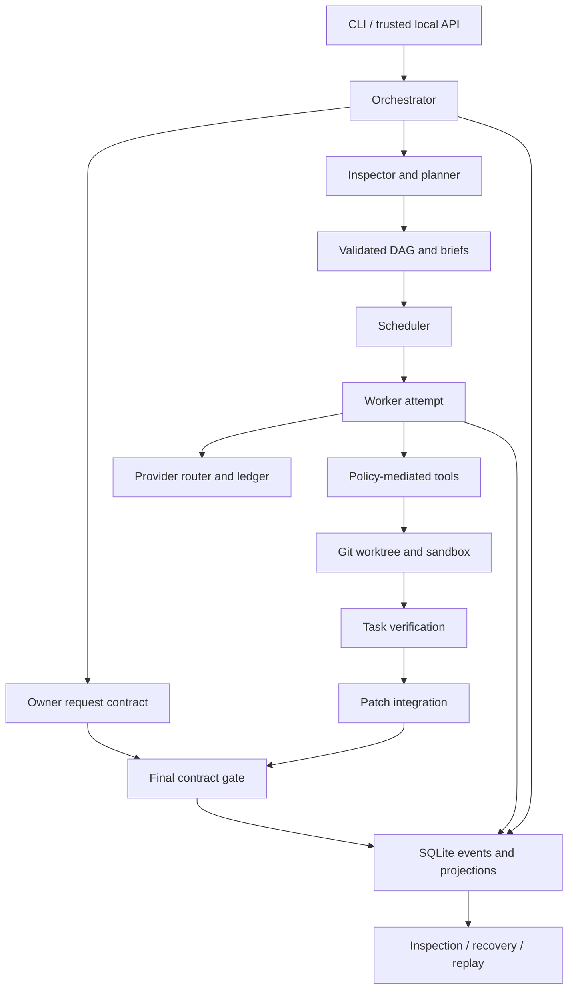

# Architecture

[Documentation home](README.md) · [Project guide](project-guide.md) · [Deep dive](deep-dive.md)

This is the current component map at documentation baseline `f8404f0`. It
explains responsibility and data flow; it does not certify every declared
boundary. Historical experiments and design decisions have their own versions.

## System boundaries

Orkestr is a single-host application with a deterministic control plane around
model-driven planning and worker loops. Git stores candidate source trees;
SQLite stores the run history and projections. Providers, worker commands and
humans are different participants with different authority.

## Component ownership

All package paths below are relative to `src/agent_squad/`.

| Component | Main paths | Responsibility |
|---|---|---|
| Composition root | `orchestrator.py`, `config.py` | Effective configuration, run context, providers, graph, result assembly and teardown |
| Request semantics | `models/contract.py`, `planning/contract.py` | Owner outcomes, semantic identity, content hash and preservation |
| Planning | `planning/inspector.py`, `planning/planner.py`, `planning/replan.py` | Repository context, typed plan, contract preservation and bounded revision |
| Graph and scheduling | `dag/graph.py`, `strategy/`, `scheduler/engine.py` | Validation, selection, readiness, attempts, dependency failure and budgets |
| Workers | `agents/base.py`, `agents/runner.py`, `agents/messaging.py` | Model/tool loop, role context, worktree lifecycle and typed communication |
| Authority | `security/`, `agents/approval.py`, `tools/` | Tool policy, approvals, command mediation and protected effects |
| Execution containment | `sandbox/limits.py`, `sandbox/containment.py`, `security/profiles.py` | Resource limits, environments, containment backend and capability probing |
| Resource lifecycle | `runtime/deadline.py`, `runtime/registry.py`, `runtime/effects.py` | Phase/deadline scope, owned resource reconciliation and effect classification |
| Model boundary | `providers/` | Protocol adapters, routing, concurrency, usage provenance and request ledger |
| Verification | `verification/checks.py`, `gate.py`, `contract_gate.py`, `protected.py` | Deterministic predicates, task evidence, final request verdict and tamper checks |
| Candidate changes | `workspace/worktree.py`, `integration/` | Git bases, patch provenance, overlap/staleness and combined candidate |
| Durable state | `store/`, `recovery.py`, `replay/` | Events, projections, artifacts, ownership, checkpoints and recorded execution |
| User surfaces | `cli/main.py`, `api/server.py`, `dashboard/` at repository root | Run control, inspection and presentation |

## Construction is not execution

Constructing an `Orchestrator` initializes run paths, a private HOME, configuration,
database, registry, providers and other services. Registry reconciliation may
inspect/reclaim abandoned resources. Construction is therefore not a read-only
operation. Do not instantiate an orchestrator merely to browse a production run;
use the inspection paths intended for that purpose.

Execution then binds the run cancellation scope, acquires durable ownership,
starts a heartbeat, checks the isolation profile, creates the deadline and
records the run. Initialization, concurrent constructors, ownership takeover and
failure cleanup must be considered together in a trust-boundary review; an
ownership helper's unit tests alone do not establish the complete guarantee.

## Request contract before planning

The owner specification supplies required outcomes. `build_contract` validates
them and refuses semantic collisions between criterion IDs. `RequestContract`
provides a stable content identity and validation used by the planning boundary.

The rule-based planner materializes structured tasks. The model planner obtains
a schema-constrained proposal and validates it as untrusted input. Normalization
may repair supported representation issues, but cannot authorize dropping an
owner requirement. A task graph is linked and checked before scheduling.

Repository contents, tool outputs and model proposals are not authority sources.
The accepted contract and configured policy define the scope within which those
inputs can influence work.

## Scheduler and worker attempt

The selector records an explainable strategy decision. The scheduler considers
ready tasks, configured worker capacity, ownership/attempt fences, task budgets,
run cancellation and remaining deadline. Per-attempt timeouts are clamped to the
run scope. Failed prerequisites block dependents rather than manufacturing their
outputs.

The worker runner creates a worktree at the appropriate base and constructs a
role-specific tool registry/context. The agent loop sends model requests through
provider routing and invokes tools only after policy checks. Its bounded result
contains observations and artifacts, not permission to self-certify the request.

Provider concurrency is separate from scheduler capacity. Two worker attempts
may share one provider semaphore. More task workers do not imply more model
servers or simultaneous GPU kernels.

## Verification has two scopes

The task gate re-executes declared criteria against worker output. A full check
record includes predicates and errors; exit code zero is only one part of the
result. Model reviews and missing checks cannot be promoted to deterministic
success.

Integration combines patches in dependency order in a staging tree. It checks
base/provenance issues and executes configured integration commands. This stage
can fail even if every individual task passed.

The final contract gate judges that candidate against the owner outcomes, using
both base and candidate observations. It distinguishes established results,
preserved invariants, unsupported pre-satisfaction and unverifiable requirements.
Protected-material checks can invalidate a candidate whose evaluator changed.
Its verdict is separate from the scheduler's execution status.

The `--no-integrate` path does not run the same final combined-tree acceptance
path. Consumers must inspect the actual contract field instead of inferring
acceptance from the CLI exit code or task counters.

## Runtime scope and teardown

Phase-aware deadline/cancellation context reaches asynchronous operations and
synchronous seams through `runtime/deadline.py`. Resource ownership is persisted
so an interrupted process can be reconciled later. Model servers and command
process groups should be registered while alive, not discovered only at shutdown.

Teardown includes provider closing, process reclamation, workspace retention/sweep
and removal of the private HOME. Explicitly retained debug workspaces need durable
ownership information. Paths such as `close()` and `aclose()` have different
behavior; callers must use the lifecycle appropriate to their execution path.
The strict score requires bounded, integrated proof of every failure branch.

## Persistence and observability

A run has a separate SQLite database in WAL mode. Events record transitions and
decisions; projections answer current-state queries. Artifacts hold patches,
evidence and model exchanges. The request ledger tracks model attempts and usage
provenance, including failure and fallback paths. These are complementary records:
ledger totals are not a substitute for a contract verdict, and a task summary may
not have the same accounting scope as all model attempts.

The local API opens the durable store rather than inventing dashboard state.
`GET /api/runs/{run_id}/contract` exposes the recorded contract and verdict.
Different product surfaces must still be checked for semantic consistency; shared
storage alone does not prevent a misleading label.

## Recovery and replay

Recovery rebuilds projections as needed, classifies interrupted attempts, takes
ownership and resumes eligible work. Ambiguous external effects require explicit
reconciliation. Durable message identities and versions survive process restart.

Replay reconstructs a recorded plan and model exchanges in scratch state, then
compares control-plane outcomes. It must not mutate the original completed run.
It cannot guarantee fresh model responses, restore an external system, or make
unrecorded side effects exactly-once.

## Architectural tradeoffs

SQLite and local worktrees favor inspectability over distributed scale. Deterministic
state transitions favor auditability over allowing models to mutate the control
plane freely. Independent final verification adds cost but prevents task-local
success from being mistaken for a combined solution. Explicit containment can
refuse a host rather than quietly promise a boundary it cannot enforce.

See the [design-decision index](design-decisions/README.md) for the original
choices, [security](security-threat-model.md) for authority boundaries, and
[limitations](limitations.md) for claims that remain unqualified.
