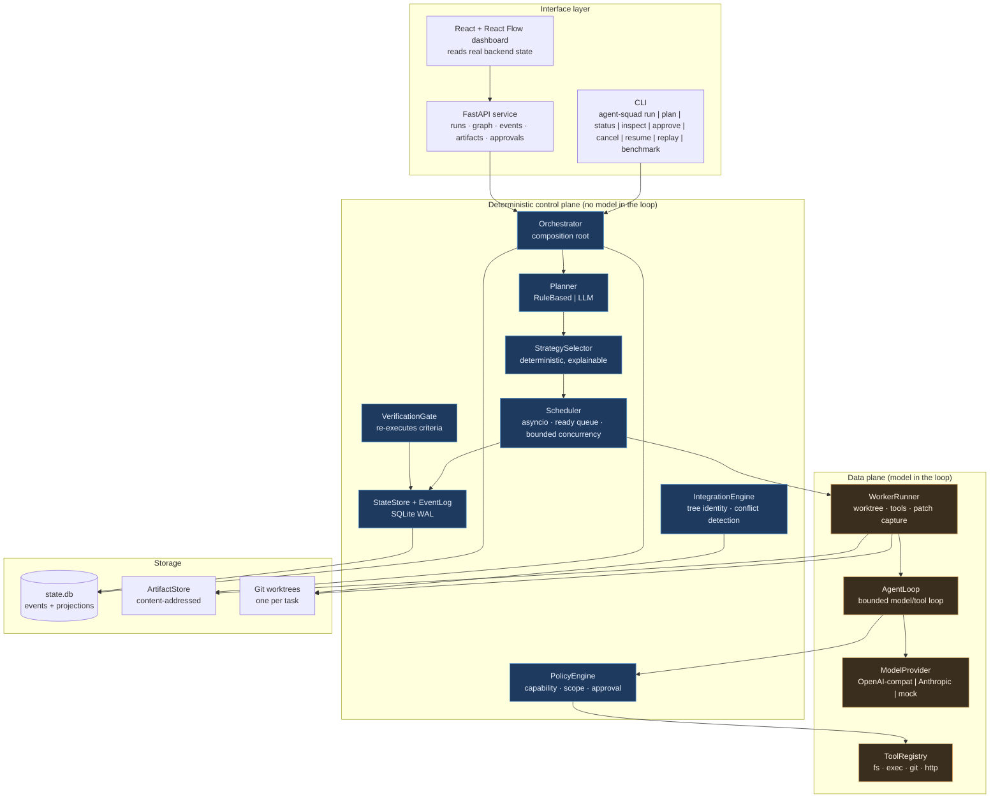
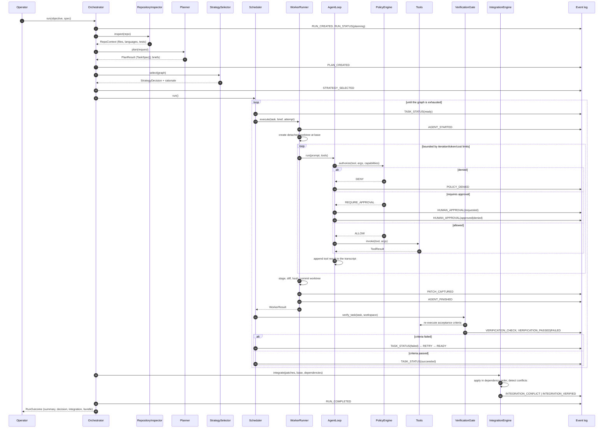
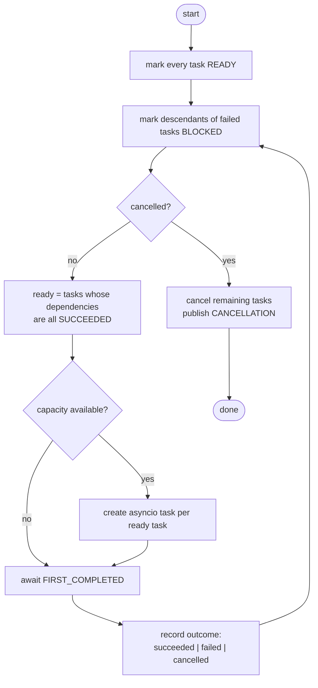
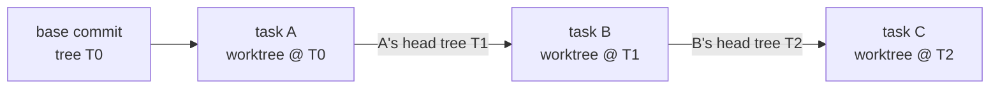
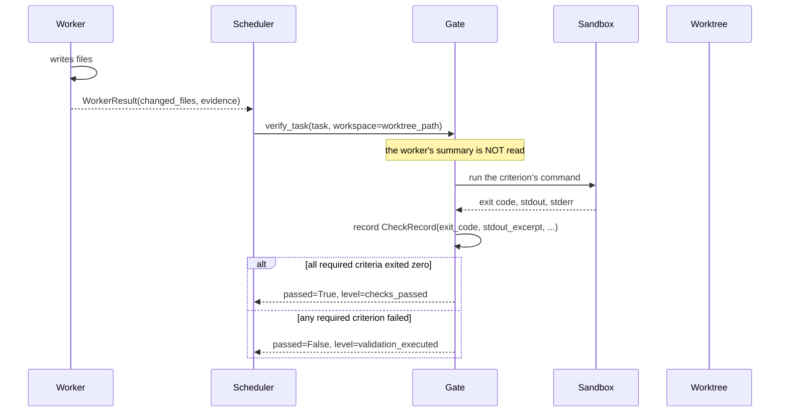
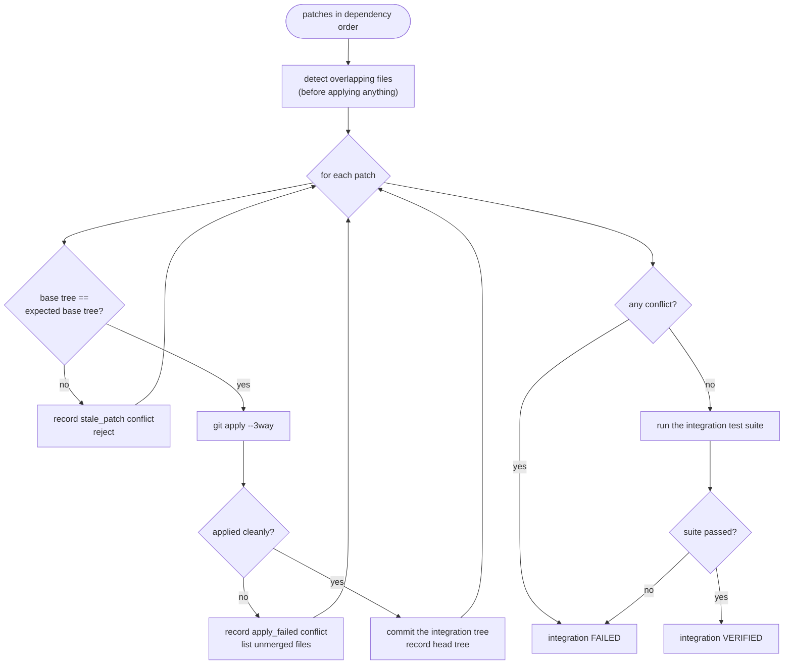
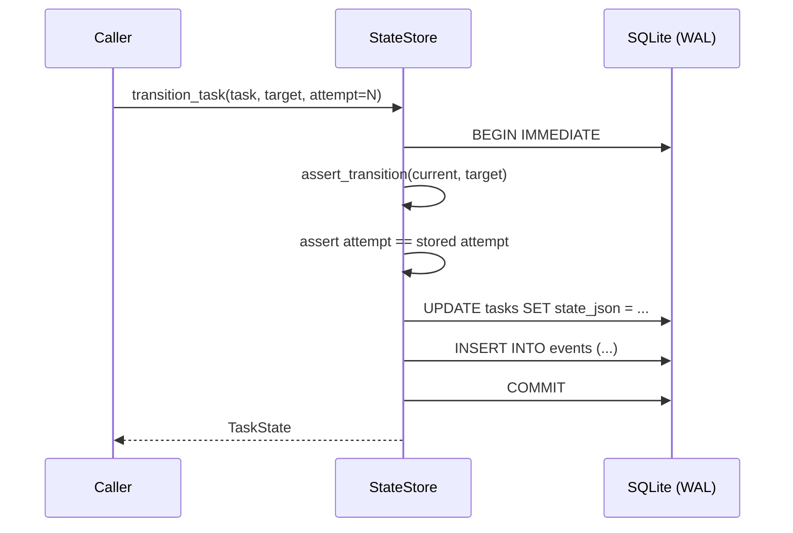
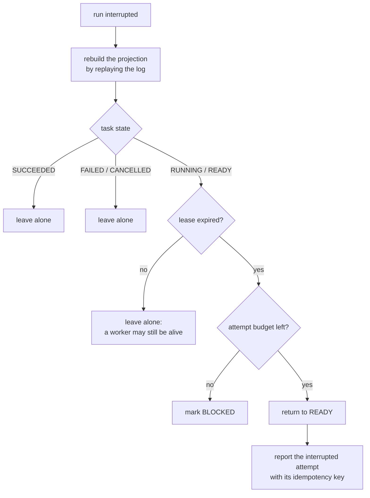
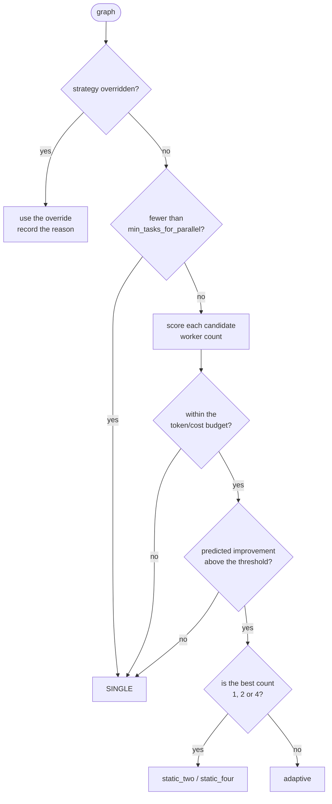
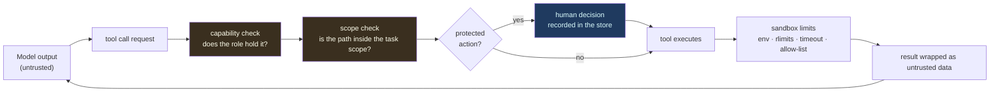

# Technical deep dive

This document is the *why* behind the machinery.  `docs/architecture.md`
describes what the system is made of; this one explains why it behaves the
way it does, precisely enough that the behaviour can be checked, argued
about, and defended.

It is organised around **invariants**.  Each section states a property the
system maintains, names the code that maintains it, and says what would
break if it were violated.

---

## 1. The invariants

These are the properties the whole design exists to guarantee.  Everything
else is machinery in service of them.

| # | Invariant | Enforced by |
|---|---|---|
| I1 | No model output can widen authority, change policy, or bypass approval | `security/policy.py:PolicyEngine.authorize`, consulted on every tool invocation |
| I2 | A task's status can only change along a legal edge of the lifecycle | `models/task.py:assert_transition`, called from `store/state.py:StateStore.transition_task` |
| I3 | A worker may only write state for the attempt it currently owns | `store/state.py:StateStore.transition_task(attempt=...)` |
| I4 | The event log is the source of truth; the projection is derived | `store/state.py:StateStore.rebuild_projection` |
| I5 | An event append and the projection update it implies are atomic | `store/db.py:Database.transaction` (`BEGIN IMMEDIATE`) |
| I6 | Acceptance criteria are re-executed by the orchestrator, not trusted from the worker | `verification/gate.py:VerificationGate.verify_task` |
| I7 | Two patches that individually pass may still fail together; the combination is re-verified | `integration/engine.py:IntegrationEngine.integrate` |
| I8 | Workers never share a live working directory | `workspace/worktree.py:WorktreeManager.create` |
| I9 | Every message is validated against a per-kind schema before it is recorded | `models/message.py:Message._validate_payload`, `agents/messaging.py:MessageBus._validate` |
| I10 | Protected actions require an explicit, recorded human decision | `agents/approval.py:ApprovalBroker.request` |
| I11 | The set of tasks that may execute is exactly the set whose dependencies are satisfied | `dag/graph.py:TaskGraph.ready_tasks` |
| I12 | A configuration knob that is accepted changes behaviour | `tests/integration/test_configuration.py` |

Read the rest of this document as the argument for each of these.

---

## 2. The layered architecture



The colour is the important distinction: **everything blue is deterministic
and model-free**.  The model (orange) can only *propose*; it can only reach
the world through the policy engine, and it can never decide whether its own
work is acceptable.

---

## 3. The run, as a sequence

This is the actual control flow of `Orchestrator.run`.  Solid arrows are
synchronous calls; dashed arrows are event-log appends.



The critical property: the only arrow from the model into the world is
`L -> T`, and it is guarded by `PE -> L`.  The worker never decides
whether its own output is acceptable; `G` does, independently.

---

## 4. The scheduler

### 4.1 The algorithm



### 4.2 Why it is correct

**Invariant I11** — *the set of executing tasks is exactly the set whose
dependencies are satisfied* — holds because:

1. `TaskGraph.ready_tasks(completed, blocked)` returns a task `t` iff
   `t.id ∉ completed`, `t.id ∉ blocked`, and every dependency of `t` is in
   `completed`. (`dag/graph.py:ready_tasks`)
2. The scheduler filters that set by `pending`, so a task that has already
   been dispatched is not dispatched twice.
3. `completed` is only ever extended with a task that reached `SUCCEEDED`,
   and a task only reaches `SUCCEEDED` after its attempt returned.

**Termination.** Each iteration of the outer loop either dispatches at least
one task (strictly decreasing `pending`) or awaits a completion event
(which strictly decreases `running` or increases `completed`).  Since
`pending` and `running` are finite and tasks are never re-dispatched once
completed, the loop terminates.  Retries are bounded by
`TaskSpec.budget.max_attempts` and by the run-level `RetryConfig`.

**No deadlock.** If `pending` is non-empty and nothing is running, then
every remaining task has an unsatisfied dependency.  Either some ancestor
failed — in which case the task was marked `BLOCKED` and removed from
`pending` — or the graph contains a cycle, which `TaskGraph.validate()`
rejects before execution starts.  Therefore the scheduler cannot spin on an
unsatisfiable graph.

### 4.3 The attempt fence (invariant I3)

The fence is the mechanism that makes concurrent workers safe to let write
to shared state.

```
Worker A                          Worker B
  | start_attempt(t) -> attempt=1    |
  | transition(RUNNING, attempt=1)   |
  |                                 | start_attempt(t) -> attempt=2
  |                                 | transition(RUNNING, attempt=2)
  | (slow)                          | transition(SUCCEEDED, attempt=2)  <- accepted
  | transition(SUCCEEDED, attempt=1) <- REJECTED: StaleAttemptError
```

The check lives in one place — `StateStore.transition_task` — and is
therefore impossible to bypass:

```python
if attempt is not None and attempt != state.attempt:
    raise StaleAttemptError(...)
```

It is evaluated *inside* the same transaction that writes the event and the
projection, so the comparison and the write cannot race.

### 4.4 Stacked worktrees

A task with dependencies starts from the head its last dependency produced,
not from the repository's base:



This is why integration must apply patches **in dependency order** and
compare *trees* rather than commit ids: B's patch was computed against
tree `T1`, and the integration tree after applying A's patch has exactly
tree `T1` — but a different commit id, because the integration engine
writes its own commit messages.  `IntegrationEngine.detect_stale` therefore
compares `git rev-parse <rev>^{tree}` values.

---

## 5. The verification chain

### 5.1 The six levels


What each level **proves**:

| Level | Proven | Not proven |
|---|---|---|
| `worker_reported` | The agent said it finished | Anything whatsoever |
| `patch_produced` | A diff exists; its SHA-256 is known | That the diff is correct |
| `validation_executed` | The orchestrator ran the specified checks | That they passed |
| `checks_passed` | Those checks ran and exited zero | That the change is complete or correct |
| `integration_validated` | The *combined* tree passes the integration suite | That the system behaviour is right |
| `human_approved` | A person authorised a protected action | — |

The ladder is strict: a level is only reached when the previous one is.
`VerificationReport.level` is set by the gate, never by a worker.

### 5.2 The gate is independent



Note the ordering: the gate runs **after** the worker, in the worker's own
worktree, against the *actual files on disk*.  It never consults the
worker's account of what it did.

### 5.3 Advisory criteria

`CheckKind.LLM_REVIEW` and `CheckKind.MANUAL` have **no deterministic
executor**.  When the gate encounters one, it records
`deterministic=False` and the criterion's state becomes `advisory` — never
`executed_passed`.  `EvidencePackage.state_for` enforces this by construction.

```python
if not record.deterministic:
    states[criterion.id] = CriterionState.ADVISORY
elif record.passed:
    states[criterion.id] = CriterionState.EXECUTED_PASSED
```

---

## 6. Integration

### 6.1 The algorithm



### 6.2 The conflict taxonomy

| Kind | Meaning | Detected |
|---|---|---|
| `overlapping_files` | Two tasks anticipated the same file | Before any application |
| `stale_patch` | The patch was computed against a tree that is not the one it should apply to | Before application, by tree comparison |
| `apply_failed` | The patch does not apply to the current tree | During application, by `git apply --3way` |

The engine **never resolves a conflict by guessing**.  An unresolved
conflict is a hard failure that must be escalated.

### 6.3 Why the combination can fail when the parts pass

The `integration_conflict` benchmark scenario demonstrates this: two tasks
each rewrite `calc.py`, each passes `file_exists`, and the combination
cannot be applied.  A system that trusted per-worker summaries would report
success.  This scenario is asserted in
`tests/chaos/test_fault_injection.py::test_conflicting_patches_are_detected_at_the_integration_boundary`
and in `tests/integration/test_integration_engine.py`.

---

## 7. The persistence model

### 7.1 Write path



Both writes are in one transaction.  A crash can therefore leave the
*projection* behind the log (recoverable by `rebuild_projection`) but never
the log behind the projection (which would be data loss).

### 7.2 Consistency guarantees, stated exactly

| Property | Guarantee | Caveat |
|---|---|---|
| Task state transitions | Exactly-once *application* of a transition | Not exactly-once *execution* of the work |
| Event append | Atomic with its projection | — |
| Reads during a run | See a consistent snapshot (WAL) | The projection may lag the log by one transaction |
| Side effects (commands, HTTP) | **At-least-once** | An interrupted attempt may repeat them; the idempotency key makes the repetition detectable, not impossible |
| Recovery | Idempotent | It never invents work and never marks a task succeeded without evidence |

The distinction in row 3 of that table is the one that matters most in an
interview: the orchestrator can say exactly-once about *its own state
machine* and exactly-nothing about *the outside world*.

### 7.3 Recovery



The "lease expired" check is what stops recovery from starting a second
worker for a task whose first worker is still running.  It only works
because `rebuild_projection` restores `lease_expires_at` from the event
log — a bug that was found and fixed during development, and is now
covered by `tests/recovery/test_recovery.py`.

---

## 8. The failure taxonomy

Each error class maps to a distinct runtime response.  The mapping is
*data*, not convention: `Scheduler._is_retryable` reads the class.

| Class | Exception | Retried? | Resulting task state |
|---|---|---|---|
| `validation` | `ValidationError`, `DependencyError` | No | `FAILED` |
| `policy` | `PolicyError`, `PolicyDeniedError` | No | `FAILED`, with an `ESCALATION` published |
| `budget` | `BudgetExceeded` | No | `FAILED` |
| `model` | `ModelError` | Only if `TransientModelError` | `FAILED` after the attempt budget |
| `tool` | `ToolError` | Yes | `FAILED` after the attempt budget |
| `timeout` | `TimeoutError_` | Yes | `TIMED_OUT` → `RETRY_SCHEDULED` |
| `conflict` | `ConflictError` | No | Integration fails; dependents blocked |
| `verification` | `VerificationError` | Yes (bounded) | `FAILED` with the failed criteria recorded |
| `stale` | `StaleAttemptError` | n/a | The write is rejected; nothing changes |
| `infrastructure` | `InfrastructureError` | Yes | `FAILED` after the attempt budget |

The distinction between `ModelError` and `TransientModelError` is the one
that stops the orchestrator burning its budget retrying a bad API key.
`providers/openai_compat.py` classifies 429 and 5xx as transient and 4xx as
permanent, and `providers/registry.py:ProviderRouter` falls back only on
transient failures.

---

## 9. The adaptive strategy

### 9.1 The decision function

The selector is deterministic: same graph, same configuration, same
decision.  That is a hard requirement for replay and for auditing.



### 9.2 The cost model

The speed-up estimate is Amdahl-like, using the graph's *real* critical
path:

```
serial_fraction   = critical_path_duration / total_duration
parallel_fraction = 1 - serial_fraction
raw_speedup       = 1 / (serial_fraction + parallel_fraction / effective_workers)
speedup           = 1 + (raw_speedup - 1) * workers^(exponent - 1)
speedup          *= 1 - min(0.5, integration_risk * 0.5)
```

`effective_workers` is `min(workers, parallel_width)`, so a chain of three
tasks cannot be "parallelised" no matter how many workers exist.

The coordination cost is charged in tokens:

```
overhead  = coordination_overhead_tokens * (workers - 1)
          + context_duplication_tokens * (workers - 1)
```

The measured effect of these estimates is reported honestly in
`docs/benchmark-results.md`: in the published benchmark, the *predicted*
22.5 % improvement on the `independent_parallel` scenario **was not
observed**, because the mock provider has no latency for the critical path
to shrink.  A selector whose predictions are published alongside the
measurements is auditable; one that is not is a guess.

---

## 10. Security model

### 10.1 Enforcement points



Three gates in series.  A denial at any of them stops the call before the
tool runs, and the denial is recorded.

### 10.2 What the isolation layers actually buy

| Layer | Isolates | Does **not** isolate |
|---|---|---|
| Capability set | *Authority* — what the agent may attempt | The host filesystem |
| Git worktree | *Code* — concurrent edits cannot interleave | Anything the user can read |
| Sandbox | *Resources* — CPU, memory, time, output size | The network (usually) or a determined attacker |

The system states this bluntly in `docs/security-threat-model.md`.  An
interviewer who asks "is the sandbox secure?" gets the honest answer: it is
defence in depth, not a boundary; `sh`, `bash` and `python3` are on the
allow-list; and `unshare --net` is usually unavailable, so outbound access
is **not** prevented — the runtime records that fact in every command
result rather than pretending otherwise.

---

## 11. Complexity and resource behaviour

| Operation | Complexity | Notes |
|---|---|---|
| `TaskGraph.validate` | O(V + E) | Kahn's algorithm plus a cycle check |
| `TaskGraph.topological_order` | O(V log V + E) | Deterministic tie-break on task id |
| `TaskGraph.critical_path` | O(V + E) | Memoised DFS |
| `TaskGraph.scope_overlaps` | O(V² · F) | F = files per task; fine at realistic sizes |
| `ready_tasks` (per scheduler tick) | O(V + E) | Called once per dispatch decision |
| Verification of one criterion | O(command) | Dominated by the subprocess |
| Integration of P patches | O(P · apply) | Plus one commit per patch |
| Event log append | O(1) amortised | Single-writer, WAL |
| Projection rebuild | O(E) | Replays the log |

The scheduler's per-tick scan is O(V + E) rather than O(1) with a
priority queue.  For the graph sizes this system targets (tens to hundreds
of tasks) that is the right trade: a priority queue adds ordering
complexity and makes the "ready set" harder to reason about, and the scan
cost is negligible next to the subprocess work each dispatch triggers.

---

## 12. Extension points

| To add… | Extend | Where |
|---|---|---|
| A model provider | `ModelProvider` | `providers/` — normalise messages, tool calls, usage, errors |
| A tool | `Tool` + `ToolRule` | `tools/` — declare the capabilities it needs |
| A role | `Role` + `capabilities_for_role` | `security/capabilities.py` |
| A check kind | `CheckKind` + an executor | `verification/checks.py` |
| A failure class | `ErrorClass` | `errors.py` — the scheduler reads it |
| A message kind | `MessageKind` + a payload model | `models/message.py` |
| A benchmark scenario | `Scenario` | `benchmark/tasks.py` |
| A fault | `Fault` + `FaultSpec` | `benchmark/chaos.py` |
| A metric | `RunMetrics` field | `observe/metrics.py` |

Every extension point is *data-driven*: adding a capability, a check kind
or a message kind does not require touching the scheduler.

---

## 13. Where the design is deliberately conservative

| Choice | Why the obvious alternative was rejected |
|---|---|
| One SQLite writer | A distributed queue adds a consistency model the research question does not need yet, and the local model is easier to *prove* correct |
| Append-only log, derived projections | Mutable state makes "what happened?" unanswerable after a crash |
| Independent re-execution of criteria | Trusting the worker's summary would make the verification layer decorative |
| Deterministic strategy selection | A learned policy needs training data from a system that does not exist yet |
| Content-addressed artifacts | Named artifacts can be overwritten; hashes cannot |
| Explicit failure taxonomy | Generic exceptions make retry and escalation guesses |

The pattern in every row: the simpler-looking design loses information that
the research question needs.
