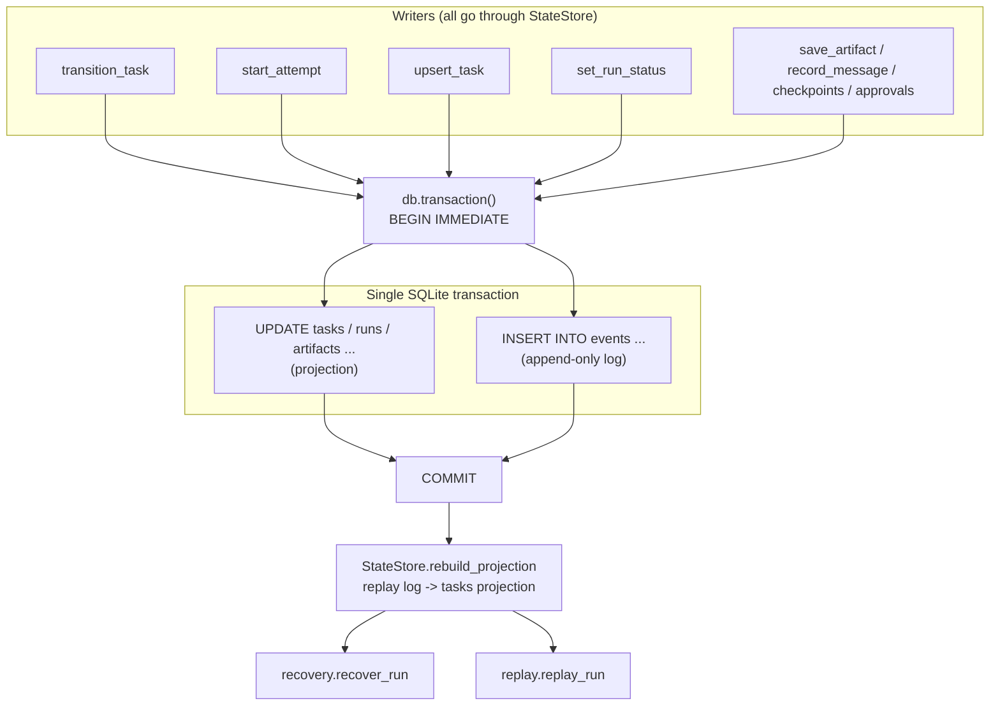

# 0003. Append-only event log with materialised projections in SQLite WAL

- Status: Accepted
- Date: 2026-11-10

## Reading this decision today

[Decision index](README.md) · [Current architecture](../architecture.md)
· [Security](../security-threat-model.md) · [Qualification](../scoring-criteria.md)

**Original decision: accepted on 2026-11-10. Context reviewed: 2026-11-11.**

The current store includes run ownership/fencing, message deduplication, approvals, checkpoints and projections. WAL backups must be consistent, and external effects remain outside a local exactly-once transition guarantee. Retention/compaction is not implied by the append-oriented design. The database is not cryptographically protected against a host user who can edit it.

The remaining sections preserve the original decision rationale and alternatives.
Their historical implementation descriptions are not a release qualification.

## Context

The runtime needs a durable record of a run that can answer three different
questions, and each question pulls towards a different storage model:

1. **What happened?** — the full ordered history of a run: plans, attempts,
   model calls, tool calls, patches, verification results, integration
   results, decisions.
2. **What is the state right now?** — the current status of every task, its
   attempt counter, its token and cost usage, its verification report, the
   pending approvals. Queried constantly, by the scheduler on every
   iteration.
3. **Can we reason about the run later?** — reconstruct the state machine,
   replay the control plane, attribute failures to categories, compare
   strategies across trials.

The obvious alternatives each satisfy some of these and fail others:

* **A task queue plus Postgres (Celery / RQ / arq + a database).** This is
  the conventional answer for durable distributed work. It is a *queue*, not
  a *history*: it holds the work to be done and discards the work already
  done. It gives no answer to question 1, and answering it requires adding
  an audit table anyway. It also introduces a broker as a required runtime
  component, an operational dependency, and a distributed-systems failure
  surface — for a runtime whose concurrency is bounded by
  `SchedulerConfig.max_workers` on one host.
* **A mutable document store (MongoDB, Redis hashes).** Fast current-state
  reads, but the write that updates state and the write that records why the
  state changed are separate operations, which reintroduces exactly the
  divergence the design is trying to eliminate.
* **An ORM with a mutable row model.** The current state is easy, but
  "what happened" degrades to whatever the application happened to write
  down, and reconstructing the state machine from it is impossible.

There is also a specific failure this design has to survive: **the process
can die at any point**, including between "the worker ran a command" and
"the result of that command was recorded". A design that stores only the
current state loses the fact that an attempt started. A design that stores
only the event log makes the current state expensive to query. The system
needs both, with a defined relationship between them.

And a second, subtler requirement: **the run must be reconstructible by a
different process.** `recovery.recover_run` and `replay.replay_run` both
rebuild the projection from the log. That requires the log to be
self-sufficient — the log must contain enough to reconstruct the state
without reference to the projection.

## Decision

**One SQLite database per run, in WAL mode, holding an append-only event log
(the source of truth) and materialised projections (derived, rebuildable).**

### The log

`store/events.py` defines `EventLog` with `append`, `append_event`,
`build`, `append_many` and `read`. There is deliberately no update and no
delete API. Each row in the `events` table carries `seq INTEGER PRIMARY KEY
AUTOINCREMENT`, a unique `event_id`, the `run_id`, an optional `task_id` and
`attempt`, the `type` (an `EventType` enum member), an `actor`, a JSON
`payload`, `created_at` and a wall-clock `recorded_at`. `EventType` has
about forty members grouped into run lifecycle, task lifecycle, agent/model/
tool, messaging/artifacts, integration/verification and durability.

### The projections

`store/state.py` defines `StateStore` with tables for `runs`, `tasks`,
`artifacts`, `messages`, `checkpoints` and `approvals`. The `tasks` table
holds both `spec_json` (the immutable `TaskSpec`) and `state_json` (the
mutable `TaskState`).

### The atomic unit

Every `StateStore` mutator opens **one** `db.transaction()` and, inside it,
writes the projection row *and* appends the event via
`EventLog.append_in_transaction(conn, event)`. `Database.transaction()`
issues `BEGIN IMMEDIATE` — which takes the write lock at transaction start
rather than at first write — and commits or rolls back on exit. A
`threading.RLock` on the `Database` serialises access to the single
connection within the process.

### The properties this buys

* **The projection can lag the log, never lead it.** Because both writes
  commit together, a crash mid-write rolls back both. There is no state in
  which the projection claims something the log does not contain.
* **The projection is disposable.** `StateStore.rebuild_projection(run_id)`
  reconstructs the `tasks` projection from `TASK_CREATED`,
  `TASK_STATUS_CHANGED` and `TASK_ATTEMPT_STARTED` events alone. Both
  `recovery.recover_run` and `replay.replay_run` call it, and the replayer
  explicitly does so to "rebuild the state machine from the log rather than
  trusting the projection: this is what makes the replay independent of the
  original process".
* **Concurrent reads do not block the writer.** WAL mode lets readers
  continue against a snapshot while the writer is mid-transaction, which
  matches the access pattern exactly: the CLI reads a run's status while the
  scheduler writes it.
* **Crash recovery is a first-class operation, not an afterthought.**
  `recovery.recover_run` rebuilds the projection, then classifies tasks:
  `SUCCEEDED` tasks are left alone; a `RUNNING`/`READY` task whose lease has
  not expired is left alone because a live worker may still own it; a task
  with no attempt budget left is moved to `BLOCKED`; the rest are returned to
  `READY` and recorded as resumable. It "never marks a task succeeded
  without evidence, and never silently discards a failed attempt".
* **The history is queryable in the shape the research needs.**
  `EventLog.read(run_id, after_seq=..., task_id=..., types=[...])` supports
  the exact slices the CLI's `inspect --events/--decisions` and the
  benchmark harness need, without a second schema.

### What is deliberately *not* claimed

The module docstrings of `store/db.py` and `scheduler/engine.py` state the
limits explicitly, and this decision inherits them:

* **No exactly-once side effects.** A task *transition* is applied once. A
  command a worker ran is not guaranteed to have run once: a worker that
  executed a command and died before recording the result will be retried,
  and the command may run again. The idempotency key
  (`f"{task_id}#{attempt}"`, surfaced by `recovery.verify_side_effects`)
  makes the repetition *detectable*; it cannot undo it. `recover_run`
  reports such attempts under `unresolved_side_effects` precisely because it
  cannot resolve them.
* **No power-loss durability.** `synchronous=NORMAL` in WAL mode does not
  fsync the WAL on every commit. The database survives a process crash; a
  host power loss can lose recently committed transactions.
* **No multi-process safety.** One writer per run is assumed.
  `MessageBus`'s duplicate-id and version tracking is in-memory and
  therefore per-process.
* **No distributed operation.** No broker, no leader election, no
  cross-host coordination.

## Alternatives considered

- **Celery / RQ / arq with a Postgres backend.** The conventional answer for
  durable work. Rejected because it answers question 2 well and question 1
  not at all: a queue is a work-set, not a history. Adding an audit table
  alongside it reintroduces the two-writes divergence this design eliminates,
  and introduces a broker and a database server as required runtime
  components for a runtime that is bounded by `max_workers` on one host. The
  dependency-gated ready queue here is ~200 lines of `asyncio` and needs no
  operations.
- **Postgres alone, with a mutable `tasks` table plus an `events` table.**
  Rejected as the same two-writes problem, mitigated by a transaction, which
  SQLite already gives for a single file. The portability benefit is real
  but the workload — one writer, a few thousand rows per run, single-host —
  does not justify a server.
- **Redis as the primary store.** Rejected on durability semantics: Redis
  persistence is asynchronous by default, and the system's whole value
  proposition rests on the record being durable. Redis would also have to be
  combined with something else to hold the history.
- **MongoDB or a document store.** Rejected because a document that is
  mutated in place cannot be the same object as the record of *why* it was
  mutated. The design requires both, and requires them to be written
  together.
- **Plain files: one JSON file per event, plus a JSON state file.** Rejected
  because the atomic update of two files is not a single atomic operation
  without an explicit protocol (write-new, fsync, rename, plus a
  reconciliation step), which is exactly the problem SQLite's transaction and
  WAL solve. Artifact blobs *are* plain files, content-addressed, because
  they are immutable and do not need atomic multi-object updates.
- **An event-sourcing library (EventStoreDB, `eventsourcing` Python
  package).** Rejected because the projections here are few, simple and
  entirely derivable from three event types, and because the attempt-fencing
  and legal-transition rules have to live in the projection update path
  regardless of the storage engine. Adding a framework's aggregate model
  would not remove any of that code.
- **Writing the event log to a remote append-only store (Kafka, NATS
  JetStream) for durability.** Rejected as a large operational cost for a
  failure mode (host power loss) that the recovery path already handles
  acceptably, and as an unnecessary step on the path from "the worker ran a
  command" to "the result was recorded".
- **Storing only the current state, with the history in application logs.**
  Rejected: it makes "what happened?" unanswerable after the fact and makes
  replay impossible, which are two of the three reasons the runtime exists.

## Consequences

**What this buys:**

- **A run is fully reconstructible by a different process.**
  `replay.replay_run` reads the log, rebuilds the projection, and can
  re-execute the control plane against the recorded model transcript
  (`RecordedProvider`) with no network access and no tokens spent.
- **Crash recovery is a policy, not a hope.** The recovery rules are
  written down and implemented, including the conservative choice to leave
  alone any task whose lease has not expired.
- **Cheap current-state queries.** The scheduler reads task state on every
  iteration; a projection table is the right shape for that.
- **One file to copy.** A run directory (`state.db`, `artifacts/`,
  `worktrees/`, `patch-bundle.diff`, `run-config.json`) is self-contained
  and can be archived or shipped.
- **A stable on-disk contract.** `EventType` values and `ErrorClass` values
  are documented as "part of the on-disk contract and must remain stable
  across releases".
- **Low operational cost.** No server, no broker, no container. `sqlite3` is
  in the standard library.

**What it costs:**

- **Single-writer by construction.** Two processes cannot drive the same
  `run_id` safely, and nothing in the code prevents them from trying.
- **Power-loss durability is weaker than a synchronous-commit engine.**
  `synchronous=NORMAL` is the deliberate trade for write throughput.
- **WAL mode has its own operational wrinkle.** `-wal` and `-shm` sidecar
  files must be carried along with the database if the run directory is
  copied, and `PRAGMA wal_checkpoint` behaviour differs from rollback-journal
  mode.
- **The projection is duplicated state.** It is a cache of the log, and it
  must be rebuilt rather than trusted after abnormal termination. The code
  does this correctly, but the invariant "the projection can lag" is
  something every future reader of the `tasks` table has to keep in mind.
- **Local filesystem as the durability substrate.** The design assumes the
  host filesystem is reliable and that the run directory is not on a
  network mount with unusual semantics.
- **Recovery does not undo side effects.** It reports them. An interrupted
  attempt that already wrote to the filesystem leaves that write in place,
  and a retry may repeat it.
