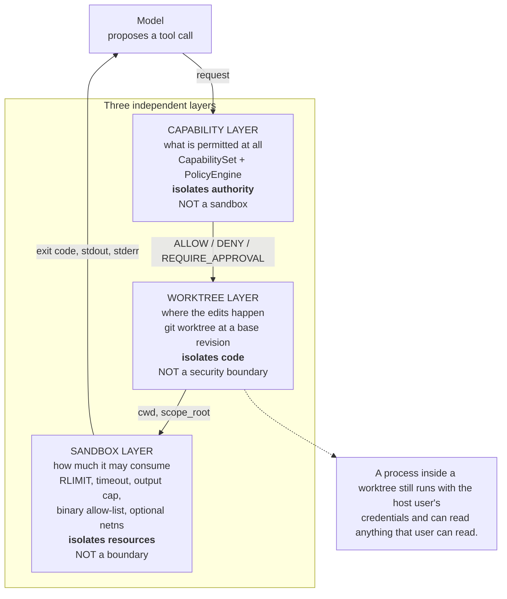

# 0004. Git worktrees for isolation, plus a capability layer

- Status: Accepted
- Date: 2026-11-10

## Reading this decision today

[Decision index](README.md) · [Current architecture](../architecture.md)
· [Security](../security-threat-model.md) · [Qualification](../scoring-criteria.md)

**Original decision: accepted on 2026-11-10. Context reviewed: 2026-11-11.**

The original worktree/capability split remains important. Development mode is best effort; hardened mode now uses a supported containment backend, private HOME and capability probes, refusing unavailable boundaries. Command scanning is not a proof of arbitrary script behavior. Read the current security model for provider authority, host capabilities and remaining qualification requirements.

The remaining sections preserve the original decision rationale and alternatives.
Their historical implementation descriptions are not a release qualification.

## Context

Multiple agents edit the same repository concurrently. That creates three
distinct problems, and they need three different answers:

1. **Concurrency.** Two workers must not interleave edits in the same
   working directory. A worker's diff must be attributable to that worker.
2. **Authority.** A worker must not be able to do things its role does not
   permit — write outside its workspace, reach the network, delete a path,
   push to a remote — regardless of what it decides to do or what an
   instruction embedded in a repository file tells it to do.
3. **Resources.** A worker running a command must not be able to consume the
   host indefinitely: no fork bomb, no unbounded output, no infinite loop.

These are frequently conflated into a single word, "isolation", and the
conflation is dangerous. A mechanism that solves one does not solve the
others:

* **Containers** solve (2) and (3) well, but are heavy: a container per
  task, image management, and a filesystem that has to be reconciled with the
  host repository afterwards. They also do not solve (1) as cheaply as git
  does — or at all, without a volume per worker.
* **Process-level isolation (chroot, namespaces, `RLIMIT_*`)** solves (3)
  and partially (2), but a `chroot` that shares the host filesystem still
  exposes the host's secrets to a process that can read them.
* **Copying the repository** per task solves (1) and gives a clean diff, but
  loses the git history and the object database, which is exactly what the
  integration stage needs in order to compute patch bases and detect stale
  patches.
* **Git worktrees** solve (1) natively, give each worker a real repository
  with real history and real objects, and make "the diff of this worktree
  against this base revision" a first-class, self-contained artefact.

The security posture also has to be stated honestly. A git worktree is a
*directory*. A process running inside it runs with the host user's
credentials, can read anything that user can read, and can write anywhere
that user can write. `workspace/worktree.py` says so directly:

> "A git worktree isolates *code*, not *authority*: a process inside the
> worktree can still read anything the host user can read. Isolation of
> authority is the job of the capability layer; isolation of resources is
> the job of the sandbox."

There is a second forcing function: the evidence chain. Because each worker
works against a *named base revision*, the orchestrator can record the base
tree and head tree of every patch, detect that a patch was computed against a
tree that is no longer current, and apply patches in dependency order. That
property falls out of worktrees for free and would have to be reconstructed
by hand under any other isolation scheme.

Finally, the system must be honest about what it claims. `sandbox/limits.py`
states that on "a normal Linux host without user namespaces it cannot stop a
determined attacker from escaping", and the summary it gives is:

> "worktrees isolate *code*, the capability layer isolates *authority*, and
> this module isolates *resources*. None of the three is a complete boundary;
> together they raise the cost of a mistake considerably."

## Decision

**Use detached git worktrees for code isolation, a static capability layer
for authority, and an `RLIMIT`-based sandbox for resources. State
explicitly that a worktree is not a security boundary.**

### Code isolation: git worktrees

`workspace/worktree.py` implements `WorktreeManager`:

* `create(task_id, base_revision=...)` runs
  `git worktree add --detach --force <path> <base>` and refuses to operate
  on a repository with no commits (`GitError`: "a worktree needs at least
  one commit").
* `commit_in_worktree(worktree, message)` stages everything and commits with
  a fixed identity (`agent-squad <agent-squad@localhost>`), returning the new
  head sha. The runner uses this to produce the `head_revision` that a
  dependent task is based on.
* `stage_all` + `diff(staged=True)` capture the patch. Staging first is
  necessary because `git diff` alone does not report untracked files, and a
  worker that creates a new module would otherwise produce an empty patch.
* `remove` runs `git worktree remove --force` followed by `git worktree
  prune` and a `shutil.rmtree` fallback.

The base revision for a task is chosen by `Scheduler._base_for(task)`: the
head produced by the last completed dependency, falling back to the run's
`base_revision`. This is why patches must be applied in dependency order at
integration time.

### The three layers, and what each one is not

The three layers answer three different questions and none of them answers
the others'. A layer that is mistaken for another produces a false sense of
confinement, which is why each is documented with an explicit non-claim.

### Authority: the capability layer

`security/capabilities.py` defines a deliberately small, coarse vocabulary —
`fs:read`, `fs:write`, `fs:delete`, `exec:run`, `exec:git`, `net:http`,
`git:commit`, `git:push`, `artifact:write`, `approval:request`, `broadcast`
— and a static `DEFAULT_ROLE_CAPABILITIES` table. `capabilities_for_role`
returns the role's set, optionally widened by configuration (and only
widened: a configuration can never remove a role's ability to report a
failure or request approval).

The coarse vocabulary is a deliberate choice, stated in the module: "Fine-
grained capabilities would multiply the number of ways the policy could be
wrong without meaningfully improving security."

`security/policy.py` adds the three-question `PolicyEngine.authorize`:
*capability* (does the caller's set permit the required capabilities?),
*scope* (is the operation confined to the permitted paths?), and *authority*
(does this require explicit human approval?). It answers `ALLOW`, `DENY` or
`REQUIRE_APPROVAL`, and records every decision — including denials — in an
audit log with redacted arguments, because "a denial is exactly the event an
operator needs to see".

The engine is consulted *before every tool invocation*.
`AgentLoop._invoke_tool` calls `PolicyEngine.authorize` with the caller's
`CapabilitySet`, the tool's registered `ToolRule`, the scope root and the
scope patterns, and only then calls `tool.invoke`. A `DENY` is returned to
the model as a tool error with `error_class="policy"` — the tool never runs,
but the agent can adapt — and `WorkerRunner._policy_hook` appends
`EventType.POLICY_DENIED` so the denial is in the durable record. A
`REQUIRE_APPROVAL` is routed to `agents/approval.py`'s `ApprovalBroker`,
which creates the request in the `approvals` table and blocks the attempt
until a human decision is recorded.

Role separation is enforced structurally rather than by prompt:
`WorkerRunner.build_tools` registers `write_file` only for `IMPLEMENTER` and
`TEST_ENGINEER`, so "the reviewer is read-only by construction: it never
receives the write tool, so a misbehaving reviewer cannot modify the tree".
The role's `CapabilitySet` is a second, independent constraint on the same
request.

### Resources: the sandbox

`sandbox/limits.py` executes commands with `os.setsid()` plus
`RLIMIT_CPU`, `RLIMIT_AS`, `RLIMIT_FSIZE` and `RLIMIT_CORE`; a wall-clock
timeout that kills the process group; an output cap; an executable
allow-list; a stripped environment containing only allow-listed variables
plus `PATH`, `HOME` and `PYTHON*`; `no_proxy=*`; and optional network
isolation via `unshare --net` when the host permits it. `RLIMIT_NPROC` is
deliberately *not* set, because on Linux it counts the whole real user's
processes and lowering it would break unrelated host processes rather than
constrain the sandbox.

The executable allow-list is matched on the executable's *basename*, and a
second condition is applied on top of it: the executable must not resolve to
a file inside the working directory. Without that second check an agent
could plant its own binary named `python3` in the worktree and have it
executed in preference to the system one, so `Sandbox.check_executable`
rejects any candidate that resolves under the working directory.

When `unshare --net` is unavailable, the outcome is recorded rather than
silently ignored: `CommandResult.isolation_note` says "network isolation
unavailable on this host (unshare --net is not permitted); outbound access
was NOT prevented".

### The explicit non-claim

Every one of the three layers documents what it does *not* provide:
`worktree.py` (code, not authority), `capabilities.py` (a policy, not a
sandbox), `limits.py` (defence in depth, not a boundary), and `config.py`'s
`SandboxConfig` docstring ("These are *local* limits... they are explicitly
**not** a security boundary").

## Alternatives considered

- **One container per task.** Rejected as the wrong trade for this workload:
  heavy per-task cost, image and dependency management, and the
  reconciliation of container filesystems back into the host repository.
  Containers are the right answer for *untrusted* code execution against a
  valuable host; here the primary risk is an agent making a mistake or
  being talked into making one, and the capability layer plus the sandbox
  addresses that at a fraction of the cost.
- **A single shared working directory with file-level locking.** Rejected:
  it does not give an attributable diff, it makes concurrent edits race, and
  it cannot express "this worker's change is relative to that revision".
- **Copying the repository directory per task.** Rejected: loses the git
  object database and history, which the integration stage needs in order to
  compute base trees and detect stale patches. It also copies
  `.git`, which is large.
- **`git clone --shared` / `git clone --reference` per task.** Rejected:
  introduces a second repository whose object store and refs must be kept in
  sync with the first. A worktree shares the object database by
  construction and adds a directory, which is exactly the primitive needed.
- **Branch-per-task instead of worktree-per-task.** Rejected: branches do
  not isolate the working tree, so two workers on two branches still share
  one checkout. The branch is useful for *recording* the result; the
  worktree is what isolates the *execution*.
- **Only the capability layer, no worktree.** Rejected: the capability layer
  restricts what a role may request but says nothing about two workers
  writing the same file at the same time, and it does not produce the
  base-relative patch artefact that the evidence chain and the integration
  stage both depend on.
- **Only the worktree, no capability layer.** Rejected: this is the
  mistaken design that treats a directory as a sandbox. A process in the
  worktree can read the host user's SSH keys, write outside the repository,
  and reach the network. The capability layer is the mechanism that makes
  authority a *property of the role* rather than a property of the
  filesystem.
- **Only the sandbox, no capability layer.** Rejected: `RLIMIT_*` bounds
  resources; it does not decide what an operation *means*. A reviewer that
  should not write files would still be able to write them within the
  limits.
- **A user namespace / bubblewrap-style sandbox as the primary boundary.**
  Rejected for now because it requires host configuration that cannot be
  assumed, and because the sandbox module already probes for the capability
  (`unshare --net`) and degrades honestly when it is absent. The right
  posture is to add a stronger boundary when a stronger boundary is
  available and to keep saying so clearly until then.
- **WASI or a pure in-process interpreter for tool execution.** Rejected as
  incompatible with the requirement that workers run real project test
  suites — which is the whole point of independent verification.

## Consequences

**What this buys:**

- **Concurrent workers cannot corrupt each other's work.** Each has its own
  directory and its own git metadata.
- **Every change is a self-contained, attributable artefact.** A patch is a
  diff against a named base revision, content-addressed in the artifact
  store with its SHA-256, its base tree and its head tree.
- **Dependency-ordered integration is possible.** Because the base of a
  dependent task is the head of its dependency, the orchestrator can sort
  patches topologically and detect staleness by comparing trees rather than
  commit ids — necessary because the integration engine makes its own
  commits for the same content.
- **Authority is a property of the role, not of the prompt.** A misbehaving
  reviewer cannot modify the tree because it never receives the write tool.
  An injected instruction in a repository file cannot grant a capability,
  because capabilities are fixed in code.
- **The main repository is never modified.** Workers operate in worktrees and
  the integrated result lives in the integration worktree; the end-to-end
  test asserts that the source file is unchanged after a run.
- **The security posture is auditable.** Each layer states what it does and
  does not provide, so an operator can reason about the residual risk
  instead of assuming a guarantee that does not exist.

**What it costs:**

- **A real repository is required.** `WorktreeManager.create` fails on a
  repository with no commits, so the runtime cannot start from an empty
  directory.
- **Disk usage.** Each concurrent task holds a checkout plus a worktree's
  `.git` administrative files. The number of live worktrees is bounded by
  `max_workers` plus one for integration, but they are not reclaimed
  automatically in the current implementation (see the cleanup-ordering
  limitation in `docs/architecture.md`).
- **Three layers to keep consistent.** A capability, a tool rule and a
  sandbox allow-list must agree for an operation to be possible; a mismatch
  produces either a false denial or an unintended permission.
- **The sandbox is genuinely weak against a determined attacker.** `RLIMIT_*`
  raises the cost of abuse; it does not prevent escape on a host without
  user namespaces. Network isolation is best-effort and may be unavailable.
- **The approval wait is synchronous and blocks a worker slot.** When the
  policy engine returns `REQUIRE_APPROVAL`, the worker's attempt blocks in
  `ApprovalBroker.request` until a human decision is recorded in the durable
  store or `ApprovalConfig.approval_timeout_s` elapses. The scheduler's
  concurrency slot is occupied throughout, and `TaskStatus.AWAITING_APPROVAL`
  is never entered even though the transition is legal, so the durable
  record shows the task as `RUNNING` while it waits. A task deadline can
  fire while the approval is outstanding.
- **Operator actions are gated by configuration, and the defaults are
  strict.** `ApprovalConfig` requires approval for git commit, git push,
  network access and deletion by default, with `protected_paths` empty.
