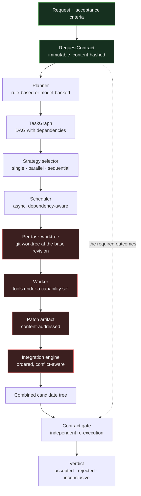

# Implementation walkthrough

A guided tour of the code, following one request from the command line to a
verified patch bundle. Every function named here exists in the tree at the
time of writing.

---

## 0. The shape of the thing



The single most important line in that diagram is the dashed one: the
**required outcomes** come from the owner's contract, not from the
plan and not from the worker. Everything else in the system can be
produced by a model; the contract cannot. That is what makes the verdict
at the end an independent judgement rather than the model's opinion of
its own work.

```
agent-squad run "..." --repo . --spec request.json
        │
        ▼
  cli/main.py :: cmd_run
        │
        ▼
  orchestrator.py :: Orchestrator.run
        │
        ├── RepositoryInspector.inspect        (read-only repo survey)
        ├── build_planner(...).plan(...)       (rule-based or LLM)
        ├── TaskGraph.validate / topological_order
        ├── StrategySelector.select            (deterministic decision)
        ├── Scheduler.run                      (asyncio, bounded concurrency)
        │      └── WorkerRunner.execute
        │             ├── WorktreeManager.create      (git worktree)
        │             ├── AgentLoop.run               (model ↔ tool loop)
        │             ├── PolicyEngine.authorize      (capability check)
        │             └── ToolRegistry                (actual side effects)
        ├── VerificationGate.verify_task      (independent re-execution)
        ├── IntegrationEngine.integrate        (patch combination + conflicts)
        └── EventLog / ArtifactStore           (durable record)
```

---

## 1. Configuration: everything is data

`src/agent_squad/config.py`

Every knob that affects behaviour lives in a pydantic model that is
`frozen=True` and `extra="forbid"`. A typo in a TOML config file raises
rather than silently disabling a safety control.

```python
config = RunConfig(
    run_id="run_01JQ...",
    repo_path="/path/to/repo",
    provider={"name": "mock", "model": "mock-deterministic-v1"},
    scheduler={"max_workers": 4},
    verification={"integration_test_command": ("python3", "-m", "pytest", "-q")},
)
```

The configuration is serialised to `run-config.json` inside the run
directory. That file is what makes a run reproducible: the replay machinery
reads it back rather than asking the operator to reconstruct it.

---

## 2. The task specification and its lifecycle

`src/agent_squad/models/task.py`

`TaskSpec` is the immutable description; `TaskState` is the mutable
execution state. The two are separated so that a replan can replace a
specification without losing the execution history.

The lifecycle is a table, not a set of `if` statements:

```python
LEGAL_TRANSITIONS: dict[TaskStatus, frozenset[TaskStatus]] = {
    TaskStatus.PENDING: frozenset({READY, BLOCKED, CANCELLED}),
    TaskStatus.READY:   frozenset({RUNNING, PENDING, BLOCKED, CANCELLED}),
    TaskStatus.RUNNING: frozenset({SUCCEEDED, FAILED, TIMED_OUT,
                                   RETRY_SCHEDULED, AWAITING_APPROVAL,
                                   CANCELLED, READY, BLOCKED}),
    ...
}
```

Every status change goes through `assert_transition`, which raises
`ValidationError` on an illegal move. The scheduler, the recovery path and
the CLI all mutate state through the same guarded API, so an illegal
transition is a bug that surfaces immediately rather than a subtly corrupt
run.

`RUNNING → READY` exists specifically for recovery: a worker that died
returns its task to the queue.

---

## 3. The graph

`src/agent_squad/dag/graph.py`

The graph is the central structure: it encodes *what may run when*, and
therefore everything that must be validated before any worker is dispatched.

`TaskGraph.validate()` raises `DependencyError` for structural problems that
make execution impossible (cycle, dangling dependency, delegation depth) and
returns a list of soft warnings for policy problems (a task with no
deterministic acceptance criteria).

Two properties of the graph are used directly by the strategy selector:

- `parallel_width()` — the maximum number of tasks that could run at once.
- `critical_path()` — the longest dependency chain by estimated duration.

and one by the integration engine:

- `scope_overlaps()` — which pairs of tasks anticipate touching the same
  files.

---

## 4. Planning

`src/agent_squad/planning/`

Three pieces:

**`inspector.py`** surveys the repository read-only: file counts, languages,
test files, manifests. It never executes anything from the repository, it
does not follow symlinks, and it scans file contents for injection patterns.
Its output is deliberately shallow — context explosion starts with fetching
whole files into the orchestrator.

**`brief.py`** defines `TaskBrief`: the structured contract between the
planner and a worker. It is data, not a prompt. The worker renders it into a
prompt; the runtime can validate it.

**`planner.py`** provides two planners with the same output type:

- `RuleBasedPlanner` consumes a structured request (JSON) and materialises
  exactly the tasks described. It is the planner used with the mock
  provider, and the one used by the benchmark harness.
- `LLMPlanner` asks a model for the same structure, then validates it.
  Model output that does not validate is a hard failure: the orchestrator
  never "repairs" a plan by guessing what the model probably meant.

```python
plan = await planner.plan(PlanRequest(...))
graph = plan.graph()          # a validated TaskGraph
```

---

## 5. The strategy selector

`src/agent_squad/strategy/`

`CoordinationModel` estimates the benefit of parallelism (Amdahl-like, from
the critical path fraction and the graph's parallel width) and its cost
(coordination tokens, context duplication, integration risk from shared
files).

`StrategySelector.select` compares the candidate worker counts and picks one.
It is **deterministic**: the same graph and configuration always produce the
same decision, which is a hard requirement for replay and for auditing.

The decision carries its reasoning:

```python
StrategyDecision(
    strategy=StrategyName.STATIC_TWO,
    worker_count=2,
    estimated_parallel_speedup=1.83,
    rationale=(
        "serial execution estimated at 120.0s; best parallel option uses 2 worker(s) at ~65.6s",
        "parallelism improves estimated wall-clock time by 45.3%",
        "selected the static 2-agent strategy because the graph width and budget both support a fixed worker count",
    ),
)
```

The selector can also decline to parallelise at all, and it must: a single
task, or a graph whose width is 1, or a budget that cannot absorb the
overhead, all resolve to `StrategyName.SINGLE`.

---

## 6. The scheduler

`src/agent_squad/scheduler/engine.py`

The scheduler owns the ready queue, the concurrency limit, retries,
deadlines and cancellation.

```python
while pending or running:
    newly_blocked = graph.blocked_by_failure(failed) - blocked - completed
    ...
    ready = [t for t in pending if all(dep in completed for dep in t.depends_on)]
    while ready and len(running) < self.max_workers:
        running[asyncio.create_task(self._execute(task))] = task.id
    done, _ = await asyncio.wait(running.keys(), return_when=FIRST_COMPLETED)
```

`_execute` runs one task through its attempts:

```
start_attempt()          # increments the attempt, takes a lease
transition RUNNING
  ├─ worker ok → verify → SUCCEEDED
  ├─ worker failed → FAILED → (retry) READY
  ├─ timeout     → TIMED_OUT → RETRY_SCHEDULED → READY
  └─ cancelled   → CANCELLED
```

Three properties are worth calling out:

**Attempt fencing.** `StateStore.transition_task(..., attempt=N)` refuses an
update whose attempt does not match the stored one. A late message from a
superseded worker is rejected rather than overwriting a newer result.

**Stacked worktrees.** A task with dependencies starts from the head
produced by its last completed dependency, so dependent work sees the
changes it depends on. The patch a task produces is relative to *that* base,
which is why integration replays patches in dependency order.

**Deterministic backoff.** The jitter is derived from
`hashlib.sha256(run_id:task_id:attempt)` rather than randomness, so it
de-synchronises concurrent workers while remaining reproducible across
processes and across replays.

---

## 7. The worker

`src/agent_squad/agents/runner.py` and `src/agent_squad/agents/base.py`

`WorkerRunner.execute` is the unit that actually does work:

1. create a detached git worktree at the task's base revision;
2. build the tool context and the prompt from the brief;
3. run the bounded agent loop;
4. stage the changes and capture the diff as a content-addressed patch
   artifact;
5. commit the worktree so dependents can be based on it;
6. build a proof-carrying evidence package;
7. publish the artifacts and report the outcome.

`AgentLoop.run` is the model/tool loop:

```python
for iteration in range(self.max_iterations):
    response = await self.provider.complete(request)
    if not response.tool_calls:
        ok = True
        break
    for call in response.tool_calls:
        result = await self._invoke_tool(call, tool_context, capabilities)
        messages.append(ChatMessage(role="tool", content=render(result), ...))
```

Three limits bound it, each with a distinct outcome: the iteration limit, the
turn token limit, and the task's token/cost ceiling.

`_invoke_tool` is where authorisation happens:

```python
decision = self.policy.authorize(
    run_id=..., actor=..., capabilities=capabilities,
    tool=call.name, arguments=call.arguments,
    scope_root=..., scope_patterns=...,
)
if decision.decision is DENY:
    return ToolResult(ok=False, error="policy denied this call: ...", error_class="policy")
if decision.decision is REQUIRE_APPROVAL:
    approved = await self.approver(action=..., rationale=..., ...)
    if not approved:
        return ToolResult(ok=False, error="this action requires human approval ...")
```

A denial is returned to the model as a tool error — the agent can adapt —
but the tool never runs.

Tool results are wrapped before returning to the model:

```python
body = wrap_untrusted(redact_secrets(payload), source=f"tool:{call.name}")
```

Untrusted content is fenced as data. The mechanism is labelling plus
labour; the actual barrier is the capability layer.

---

## 8. Verification

`src/agent_squad/verification/`

The gate re-executes the acceptance criteria itself, in the task's
worktree, and records what happened:

```python
report = await self.gate.verify_task(
    task, workspace=Path(worktree), has_changes=bool(result.changed_files),
    evidence=result.evidence,
)
```

`CheckKind` selects the executor: `file_exists`, `file_contains`,
`file_not_contains`, `command_exits_zero`, `command_output_matches`,
`pytest_selector`, `diff_nonempty`, `diff_empty`. Two kinds —
`llm_review` and `manual` — have **no deterministic executor** and are
reported as `advisory`, never as passed.

The report carries a `level`:

```
none → worker_reported → patch_produced → validation_executed
     → checks_passed → integration_validated → human_approved
```

`checks_passed` means: the specified checks ran and produced these
results. Not that the change is correct.

---

## 9. Integration

`src/agent_squad/integration/engine.py`

Patches are applied in dependency order to a fresh integration worktree.
Before each application the engine compares the *tree* the patch was
computed against with the integration tree's current tree:

```python
expected_tree = patch.base_tree or self._tree_of(patch.base_revision)
if expected_tree and current_tree and expected_tree != current_tree:
    # stale patch -> rejected
```

Trees are compared rather than commit ids because the integration engine
creates its own commits for the same content.

Overlapping file modifications are detected *before* application, so the
operator gets an explanation rather than a merge-conflict dump. Any
unresolved conflict is a hard failure: the engine never "resolves" a
conflict by guessing.

The integration test command is then run against the combined tree. If it
fails, the integration fails — even though every individual worker reported
success.

---

## 10. Durable state

`src/agent_squad/store/`

`Database` wraps SQLite in WAL mode. `EventLog` is append-only;
`StateStore` holds the projections.

The invariant that matters:

> The event log is the source of truth. The projection tables are derived
> and can always be rebuilt by replaying the log.

The event append and the projection update happen in one transaction
(`BEGIN IMMEDIATE`), so a crash can leave the projection behind — which
`StateStore.rebuild_projection` repairs — but never the reverse.

`StateStore.transition_task` enforces the lifecycle table and the attempt
fence in the same transaction that writes the event.

---

## 11. Recovery

`src/agent_squad/recovery.py`

```python
report = recover_run(run_id, data_dir=data_dir)
result = await resume_run(run_id, data_dir=data_dir)
```

`recover_run` rebuilds the projection from the log, then classifies each
task. A task that was `RUNNING` when the process died is *not* assumed to
have finished: if its lease has expired and it has attempt budget left, it
returns to the ready queue; if it has no budget left, it is blocked.

`resume_run` then re-reads the configuration and the plan from durable
storage and restarts the scheduler from that point. Work that already
succeeded is not repeated.

Recovery does not undo side effects. `verify_side_effects` lists the
attempts that started but never recorded an outcome, with their idempotency
keys, so that an operator or a reconciliation job can decide what to do.

---

## 12. Replay

`src/agent_squad/replay/`

`RecordingProvider` wraps the provider and records every exchange as an
artifact. `RecordedProvider` serves those recorded responses without any
network call.

`replay_run` reconstructs the state machine from the event log (not from the
projection — the point is to be independent of the original process) and
returns the recorded decisions, the transition sequence and the final state.

With `execute=True` it re-runs the *control plane* against the recorded
transcript and reports whether the replayed execution produced the same
task outcomes. It is a replay, not an evaluation: the model never thinks
again.

---

## 13. The benchmark

`src/agent_squad/benchmark/`

`run_suite` runs every scenario under every strategy on a freshly created
repository, then derives the metrics from each run's own event log. The
harness contains no hard-coded expectations about a scenario's outcome,
because a benchmark that knows the answer is not a benchmark.

`render_report` prints the aggregate table and *every* comparison against
the baseline, including the ones where the candidate lost.

---

## 14. A complete trace through the mock provider

The mock provider is not a stub. It reads a structured task brief from the
prompt and emits genuine tool calls:

```
prompt ──▶ AgentLoop ──▶ MockProvider.complete()
                             │
                             ├─ parses the brief (BRIEF_START … BRIEF_END)
                             ├─ emits write_file calls for each edit
                             ├─ emits run_command calls for each command
                             └─ on the second call (tool results present)
                                emits a summary and no further tool calls
```

That is why the offline path produces real diffs, real test runs and real
integration conflicts — the parts of the system most likely to be wrong are
actually exercised.

---

## 15. Where to start reading

| If you want to understand… | Read |
|---|---|
| What the system does | `docs/architecture.md` |
| Why it is built this way | `docs/design-decisions/` |
| What it cannot do | `docs/limitations.md` |
| What can go wrong and what happens | `docs/reliability.md` |
| Who might attack it and how | `docs/security-threat-model.md` |
| Whether multi-agent helps | `docs/benchmark-results.md` |
