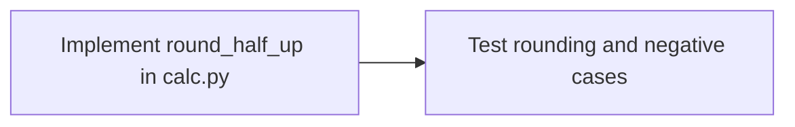

# Orkestr explained in depth

[Documentation home](README.md) · [Quickstart](getting-started.md) · [Architecture](architecture.md)

## The problem the project addresses

Giving a language model repository access is easy compared with deciding whether
its work is complete, safe to combine, worth its cost, and recoverable after an
interruption. Adding more models creates more coordination questions: which
changes depend on which others, whether agents edit the same file, whether a
retry duplicates an effect, and whether a passing local test still passes after
patches are combined.

Orkestr treats these as runtime responsibilities. Models propose plans and tool
calls. Ordinary application code validates the graph, gates authority, schedules
attempts, executes checks and records events. The project investigates when
coordination improves on a strong single-agent baseline rather than assuming
that additional workers are an improvement.

It is useful to think of Orkestr as a small workflow engine specialized for
repository changes. Git supplies candidate trees and patches; SQLite supplies
execution history and projections; adapters supply model responses; explicit
verification supplies the acceptance boundary. The surrounding application
makes these pieces inspectable through a CLI, a local API and a dashboard.

## Five objects that should not be confused

| Object | Owner or producer | Purpose |
|---|---|---|
| Request contract | Derived from the owner's structured request | State the outcomes that cannot be weakened by planning |
| Plan / task DAG | Rule-based or model planner | Decide the work, ordering, roles and anticipated scope |
| Worker attempt | Scheduler and agent loop | Execute bounded tool/model turns in a candidate workspace |
| Evidence and contract verdict | Verification path | Record checks and judge the final combined candidate |
| Approval grant | Human decision through the broker | Authorize a precisely bound protected action |

A plan is a proposal for satisfying a request. It is not permission to redefine
success. A worker's message is a claim, not evidence. A human approving a command
is granting authority, not confirming the resulting implementation is correct.

## A worked example: implementation followed by tests

Suppose a repository contains `calc.py` and a baseline calculator test suite.
The owner asks for a rounding function and new tests. The supplied
[rounding request](../examples/request-rounding.json) expresses two tasks:



The dependency is functional: the test task needs to import the implementation.
Making both workers ready immediately would give the test worker an obsolete
view of the code. The scheduler therefore starts the implementation first and
uses a dependency-aware base revision for the second workspace.

The owner also supplies criteria: the helper symbol must exist, a real change
must be produced, the test file must exist, and its selected tests must pass.
These are deliberately simple demonstration criteria. They do not establish
correct rounding for every possible floating-point value. A production request
would need a stronger, separately owned oracle and a clear numerical contract.

### Step 1: capture intent before model planning

`planning/contract.py` builds the request contract from the owner-supplied JSON.
Repeated criterion IDs with different semantics are rejected. The contract is
content-hashed, and a planner must preserve the original required outcomes.
Adding a supplementary check can strengthen a plan; replacing “test the new
function” with “the old test file exists” cannot satisfy the same contract.

A free-text objective without structured criteria has no independent required
outcomes. The honest result is not automatically accepted simply because a
model confidently says it is finished. This is a product constraint: callers
that want meaningful acceptance must first state what will count as success.

### Step 2: inspect and validate the proposed graph

Repository inspection supplies bounded context. The planner turns the request
into typed tasks and briefs. Graph validation rejects missing dependencies,
cycles and invalid roles or fields before workers start. A task contains both
execution intent and information for scheduling: expected files, duration,
complexity, scope and budgets.

The mock planner materializes the structured example deterministically. A real
model can propose a different decomposition, but cannot legitimately weaken the
owner's required outcomes. Validating JSON is necessary; preserving the meaning
of required criteria is a separate check.

### Step 3: choose a strategy, then respect real resources

The scheduler can run a single worker, fixed worker counts, or an adaptive
selection. The selector estimates task parallelism, critical path, duplicated
context, coordination and shared-file risk. It is a heuristic, not a demonstrated
universal optimizer. Predicted speedup must be compared with recorded outcomes.

Two ready tasks do not imply two simultaneous model requests. Provider concurrency
may serialize requests, and a 4-GiB GPU may not fit two loaded models. Model load,
KV cache, host RAM, tool subprocesses and verification can all become bottlenecks.
Counting agents alone says little about actual throughput.

### Step 4: execute an attempt in its own workspace

A worker receives a task brief and a Git worktree. The agent loop asks the
provider for a response, interprets supported tool calls and invokes registered
tools through policy checks. It may inspect files, write allowed files, run
commands, inspect Git changes or request a protected action.

The loop is bounded by role iterations, token/cost limits, task timeouts and the
run's phase/deadline scope. A retry is another attempt, with its own fence and
history; it must not let an older attempt overwrite a newer result. When an
approval is necessary, the broker records a request and waits for a decision
bound to the action and its context.

Git worktrees separate candidate source trees. They do not, by themselves,
prevent reading the user's credentials or sending network requests. Development
mode and hardened containment make different promises, explained in the
[security model](security-threat-model.md).

### Step 5: verify task output independently of its summary

A task verifier re-executes deterministic checks. It records the command,
result, output excerpt, timing and errors. A command that exits zero but fails
an output predicate is a failing check. Model reviews and manual criteria do
not become deterministic evidence just because they sound convincing.

The task may produce a hashed patch and pass its declared checks. That is still
only one task's result. For example, two patches can each pass against their
own bases and fail when combined, or one task can change an API that a later
patch expects to remain unchanged.

### Step 6: integrate and judge the combined tree

Integration combines patches in dependency order in a staging workspace, checks
staleness and conflicts, and executes configured integration checks. Internal
commits may establish dependency bases without publishing anything to a remote.
The result remains reviewable as a patch bundle and artifacts.

The contract gate evaluates the final candidate against the original request.
It considers the base state as well as the candidate state so an unchanged
baseline is not mistaken for completed new work. The current outcome model also
distinguishes preserved invariants from new outcomes; an existing baseline
requirement can remain true while another requirement establishes a new change.
A permitted no-op must be explicit rather than a loophole for doing nothing.

The returned run contains both execution status and a contract verdict. The CLI
currently derives its exit code from execution status. A consumer that requires
request acceptance must explicitly check `contract.outcome == "accepted"` and
handle absent, rejected, inconclusive, timed-out and cancelled verdicts.

## Reading the worked example as evidence

A useful review starts with the actual request and candidate, then asks what each
observation establishes. For the rounding example, the following table describes
the intended distinction; inspect the run's recorded verdict for its actual case.

| Owner criterion | Base observation | Candidate observation | Interpretation |
|---|---|---|---|
| `calc.py` exists | Already true | Still true after implementation edits | A preserved baseline property, not proof of a new helper by itself |
| New rounding symbol exists | False | True | Evidence of the requested structural addition |
| A change was produced | False for the base | True for the combined change | Evidence of a non-empty candidate, not functional correctness |
| New test module exists | False | True | Evidence that the requested test file was added |
| Selected rounding tests pass | Missing/failing on base | Passing on candidate | Evidence for those selected behaviors under the recorded environment |

The owner still has to ask whether these checks are sufficient. A function can
have the right name and incorrect behavior. A worker-created test can assert too
little. A previously passing regression suite can miss the newly introduced edge
case. These are specification/oracle limits, not problems solved by adding a
second agent or hashing the same weak check.

A condensed result might contain the following fields. This is a structural
excerpt, not a complete response schema or a new benchmark measurement:

```json
{
  "status": "succeeded",
  "contract": {
    "outcome": "accepted"
  }
}
```

If the contract field is absent or its outcome is different, automation must not
silently substitute `status`. Read the full check records and contract/candidate
identities before acting on the result. Human authorization for a commit or push
is a separate decision from whether the candidate passed the request checks.

## Where time and cost go

A useful conceptual decomposition is:

```text
run time = startup + inspection + planning + scheduled critical path
         + final verification/integration + teardown
```

Queueing, retries and contention contribute to those terms; this is an explanatory
decomposition rather than the selector's literal prediction formula. A two-task
dependency chain has one ready task at each stage, so configuring two workers
cannot eliminate that dependency. Independent tasks offer overlap, but provider
serialization, shared files and memory limits can remove the expected benefit.

Token/cost overhead can rise even when the wall time improves. Workers may receive
overlapping repository context, a reviewer may add calls, and a fallback repeats
some work. Conversely, shorter prompts and a better task split may help a small
model fit a context limit. Measure the whole request ledger and the independently
accepted result together. Optimizing token throughput while losing acceptance is
not the same as improving developer productivity.

## How the system remembers what happened

Each run has its own data directory and SQLite database. Events record decisions
and transitions; projections provide current state efficiently. Content-addressed
artifacts store patches, evidence and recorded model exchanges. Checkpoints mark
positions in the history for recovery and inspection.

This separation supports two different operations:

- **Recovery/resume** reconstructs durable state, takes ownership and decides
  which attempts can continue. It may need to reconcile external effects.
- **Replay** reconstructs recorded control-plane behavior using recorded model
  exchanges. It does not ask a model to think again or prove that today's live
  endpoint would produce the same response.

A fencing token prevents an old owner from continuing authoritative writes
after takeover. Durable message deduplication prevents a process restart from
forgetting already delivered message identities. Neither mechanism makes an
arbitrary database write or external HTTP effect exactly-once automatically.

## Why this architecture is deliberately local

One host, Git worktrees and SQLite are inspectable and inexpensive to run.
They make it possible to reproduce scheduling, integration and recovery failures
without operating a distributed cluster. They also set a clear limit: this is
not currently a multi-tenant service with distributed placement and shared-run
consensus. Adding a queue would not solve those authority and ownership problems.

The local design is especially useful for experiments. The same orchestrator can
be driven by a deterministic mock or a real compatible endpoint. The mock helps
isolate orchestration logic; the model path exposes output-format, context,
reasoning-budget and hardware constraints that the mock intentionally omits.

## What the measurements establish

The deterministic benchmark measures orchestration around known tool behavior.
The historical local sweep measures small-model workflow compatibility under its
specific limits. The direct probes score five tiny tasks. The later clean timing
sample demonstrates resource-ownership checks on three model configurations.
The generated verifier corpus tests selected acceptance mechanisms.

These are complementary experiments, not interchangeable accuracy scores.
Historical worker successes predate the newer contract boundary, the original
GPU/CPU timings included a residual server, and generated cases are not evidence
of solving unfamiliar repository issues. The [evaluation guide](evaluation.md)
explains the denominators, caveats and missing qualification evidence.

## What would make the project substantially stronger

The next proof is end-to-end reliability on independently judged repository
changes. That requires a pinned held-out corpus, a strong single-agent baseline,
complete request accounting, valid hardware measurements and independent review
of trust boundaries. External use must show that people can inspect failures,
recover work and make informed integration decisions.

The [roadmap](roadmap.md) organizes that work. The [scoring policy](scoring-criteria.md)
requires all mandatory evidence for a formal 9.5 rating; more modules, more agents
or more generated test variants cannot substitute for the missing evidence.
